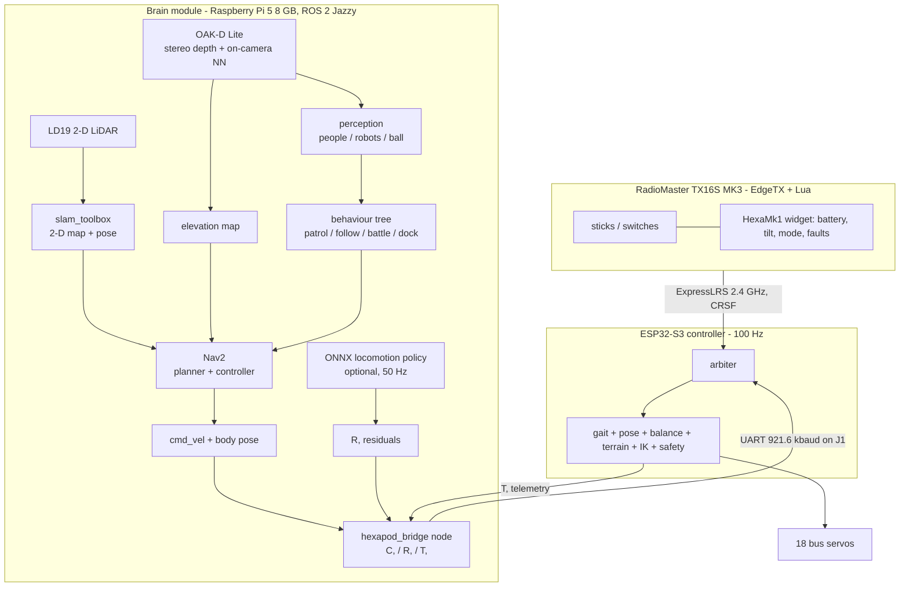

# Hexapod Mk1 (rev B2): autonomy, remote control and sim2real

**Goal.** Mk1 drives itself. The open-source radio is the override and e-stop, and the robot's behaviours can be trained in simulation and moved to the real robot.

**Split of jobs.**
- The **ESP32-S3** keeps every hard real-time loop and all safety (CONTROL.md).
- A swappable **brain module** on the top deck does perception, mapping, planning and learned locomotion.

**What exists today:**
- the module's CAD;
- its power and data path;
- the MuJoCo model;
- the training environment;
- the export and deploy path.

The ROS 2 graph is a design: there is no robot-side ROS code yet (§5).

## 1. Architecture

**Rules.**
- The brain sends **what** to do: `C,` velocities and pose, and optional `R,` joint residuals.
- The ESP32 decides **how**, and it can always refuse.
- With no radio link the brain can't drive at all.

## 2. Remote control: why EdgeTX + ExpressLRS

| Option | Open firmware | Student-programmable | Range / latency | Two-way telemetry | Cost | Verdict |
| --- | --- | --- | --- | --- | --- | --- |
| **RadioMaster TX16S MK3 (EdgeTX) + ELRS RP1 V2** | ✓ EdgeTX (GPL) + ExpressLRS (GPL) | ✓ Lua widgets, telemetry and mixer scripts on the radio; the robot side is an open CRSF parser | km-range; 2–7 ms frames at 150–500 Hz | ✓ battery, attitude, mode, link quality | ≈ $230 + $19 ([TX16S MK3](https://radiomasterrc.com/collections/radio-controller/products/tx16s-mk3-radio-controller), [RP1](https://radiomasterrc.com/collections/elrs-receivers/products/rp1-expresslrs-2-4ghz-nano-receiver)) | **Chosen** |
| RadioMaster Pocket / Boxer (EdgeTX) + RP1 | ✓ | ✓ (black-and-white screen script included) | same | ✓ | ≈ $70–140 | Budget option, same robot code |
| Bluetooth gamepad on the ESP32 (Bluepad32) | ◐ library open, pad closed | ✗ nothing to program on the pad | ≈ 10 m, BLE jitter | ✗ (rumble only) | ≈ $30 | Fine for demos; no telemetry and no e-stop range |
| Open-hardware ESP32 controller (ESP-NOW) | ✓ | ✓ | ≈ 100 m | ✓ | ≈ $40 + build | Good project, but you'd have to design the safety and the ergonomics yourself |

**Robot side** (CAD: `ELRS_RP1_Receiver`, `Harness Receiver CRSF`, `Harness Receiver antenna`):
- **Receiver.** The RP1 sits in the plastic control pod at the front left.
- **Antenna.** The stock T-antenna stands vertically in the pod lid's printed post. It is clear of the Feather's ground plane, the Pi's metal cooler and the steel screws, and nothing in the robot is carbon.
- **Link.** CRSF at 420 kbaud goes to the Feather's UART2.
- **Failsafe.** The radio is set to "no pulses". After 250 ms without frames the robot falls back to the next source. With none, it stops and crouches, then relaxes after 2 s (CONTROL.md §6).
- **Mapping and Lua screens:** [radio/README.md](../radio/README.md).

## 3. Brain module: compute choice

| | **Raspberry Pi 5 8 GB + Active Cooler** (chosen) | Jetson Orin Nano Super dev kit |
| --- | --- | --- |
| Neural networks | On the **OAK-D Lite's own 4-TOPS VPU** (detection runs on the camera) plus the Pi CPU for small MLP policies (< 1 ms) | 67 TOPS GPU |
| Power | about 5–9 W with ROS 2 + SLAM ([Pi 5 + AI HAT benchmarks ≈ 9 W](https://www.hackster.io/yahboomtechnology/raspberry-pi-5-vs-jetson-orin-nano-super-1494fe)) | 15–25 W ([same source](https://www.hackster.io/yahboomtechnology/raspberry-pi-5-vs-jetson-orin-nano-super-1494fe)) |
| Mass | 46 g + 21 g cooler | about 175 g with carrier and heatsink |
| Cost | $80 + $5 | $249 |
| ROS 2 | Ubuntu 24.04 + **ROS 2 Jazzy** (LTS to 2029), native arm64 | JetPack 6 (Ubuntu 22.04): Jazzy from source or Humble |
| Fit | Runs off 2 A at 11 V; 32–36 min walking with it on (§4) | Would need about 2–2.5 A more and a bigger pack |

**Decision.** The Pi 5, because the camera does the heavy vision. If you later need large on-board models, the Jetson drops into the same module footprint: it needs a 19 V input or its own buck, and the battery runtime falls to about 25 min.

## 4. Brain module design (`BrainBase`, `BrainLid`, `BrainCamMount` in the CAD)

**Fitting.**
- **Swappable top-deck module.** It slides onto the same dovetail as the weapons and locks with one M3 screw. The screw goes into a second insert in the receiver at (25, −10) and is reached with a hex key through the lid.
- **Electrics.** It plugs into **J1**: VBAT, 5 V, the servo bus and the AUX1/AUX2 UART.
- **Weapons.** Weapons and the brain share the top mount. For battle autonomy, the brain module carries a toy IR "laser-tag" emitter on its camera mount; a real laser is never used.

**Layout** (106 × 102 × 37 mm housing plus the LD19 on top):

| Item | Position | Notes |
| --- | --- | --- |
| Raspberry Pi 5 + Active Cooler | Floor, on 12 mm standoffs, ports to the right | Right-angle USB leads to the camera; side vents for the cooler's exhaust |
| Pololu **D36V50F5** (5 V 5.5 A buck) | Front-left, on 7 mm standoffs | VBAT from J1 → 5 V into the Pi's GPIO 5 V pins (both 5 V, both GND). Set `usb_max_current_enable=1` |
| **OAK-D Lite** | Outside the front wall on `BrainCamMount`: shelf plus two M2 screws into its rear holes, looking forward, 38–66 mm above the coxa joints | USB-C to the Pi through the front wall at x = 20 |
| **LD19** 2-D LiDAR | On the lid, centre (−8, −40) | 360° scan plane at about 90 mm above the coxa joints, above the camera |
| UART to the ESP32 | J1 AUX1/AUX2 → Pi GPIO14/15 (pins 8/10) | The Feather detects the brain at boot (CONTROL.md §2) |

**Budgets:**

| | Value |
| --- | --- |
| Mass | **300 g** (printed 93 g + Pi 46 + cooler 21 + OAK 61 + LD19 47 + buck 7 + cables and screws 25). Inside the 0.4 kg attachment allowance, so the servo load check still holds (femur 2.0× rated) |
| 5 V load | Pi about 1.2 A typical, OAK-D Lite 0.9 A (4.5 W max, [spec sheet](https://docs.luxonis.com/hardware/products/OAK-D%20Lite)), LD19 0.18 A, so about 2.3 A typical and 3.5 A peak, against the buck's 5.5 A |
| From the battery | about 14 W / 11.1 V / 0.9 efficiency ≈ **1.3–1.6 A** through J1 (fused at 5 A, PTC) |
| Runtime | walking 4–6 A + brain 1.5 A → **32–36 min** typical, 26 min worst case (3S 4000 mAh, 80 % used). A second pack hot-swaps from the rear |

**Cooling.** The Pi's Active Cooler fan pulls in through the lid vents over the ports and blows out the side vents. The OAK-D Lite has its own fins and sits outside.

## 5. Software stack (ROS 2 Jazzy on Ubuntu 24.04)

| Node | Package | Input → output |
| --- | --- | --- |
| `hexapod_bridge` (to write) | Python, pyserial | `/cmd_vel`, `/body_pose`, `/residuals` → `C,` / `R,` on the UART; `T,` / `B,` → `/imu`, `/feet`, `/battery`, `/diagnostics`, `/joint_states` |
| `robot_state_publisher` | standard | [autonomy/urdf/hexapod_mk1.urdf](../autonomy/urdf/hexapod_mk1.urdf) → TF |
| `ldlidar_stl_ros2` | LDROBOT driver | LD19 → `/scan` |
| `depthai_ros_driver` | Luxonis | OAK-D Lite → `/oak/rgb`, `/oak/stereo/depth`, `/oak/nn/detections` (YOLO on the VPU) |
| Odometry | `robot_localization` EKF | IMU + leg odometry from the commanded gait (from `T,`) → `/odom` |
| SLAM | **slam_toolbox** (2-D, lifelong) | `/scan` + `/odom` → `/map`, map → odom |
| Elevation map | `grid_map` + `elevation_mapping_cupy` (CPU mode) or a lighter depth-to-heightmap node | depth → traversability, step heights |
| Navigation | **Nav2** with the `MPPI` controller in omnidirectional mode (`vx`, `vy`, `wz`: a hexapod strafes) | → `/cmd_vel` |
| Behaviour tree | `BehaviorTree.CPP` via Nav2 BT navigator plus a custom `battle.xml` | patrol, follow-person, **battle**: find the opponent → approach to 1.5 m → strafe-circle → aim by body yaw and pitch → fire the IR tag (AUX) → retreat when battery < 25 % |
| Policy runner (optional) | onnxruntime | 71 observations → 18 residuals at 50 Hz → `/residuals` |

**For the browser sim.** Its bot can use the same behaviour tree: the states, timings and distances are in the table above. Its "autonomous" mode would then call that logic in place of the current scripted bot.

## 6. Sim2real with MuJoCo

**Files.** Everything is in [autonomy/mujoco](../autonomy/mujoco); see its README for commands.

| Piece | Status |
| --- | --- |
| `hexapod_mk1.xml` (generated by `make_mjcf.py` from the CAD report and meshes) | **Working.** Masses from the Fusion build: body + 6 × (coxa, femur, tibia), battery placed at its real position, payload body (0–0.4 kg). Joint limits; damping 0.05, frictionloss 0.03, armature 0.008–0.010. Position actuators: STS3215 kp 11 / STS3250 kp 18, force limits = stall torque 2.94 / 4.9 N·m. Foot spheres μ 0.9. Sensors: IMU framequat, gyro and accelerometer at the BNO085's position; six foot touch sensors; 18 joint positions and velocities. No equality constraints or tendons: the Mk1 leg has no linkages (KINEMATICS.md) |
| `scene_flat.xml`, `scene_terrain.xml` (200 × 200 heightfield, 6 cm bumps) | **Working** |
| `test_stand.py` | **Passes.** The robot stands at 89 mm (target 90), tilt 0.02°, all six feet loaded, femur 0.22 N·m. The firmware's tripod gait walks 0.58 m in 4 s at a 0.15 m/s command |
| `view.py` | Working (`--terrain`, `--walk`) |
| `gait_ref.py` | Python port of the firmware gait, the base the policy adds to |
| `hexapod_env.py` (Gymnasium) | **Working skeleton.** Steps, resets and randomises. The reward is a first draft |
| `train_ppo.py` (Stable-Baselines3 PPO, 8 CPU envs) | Skeleton, not yet trained |
| `export_onnx.py` | Skeleton (folds the observation normalisation into the ONNX graph) |

### Why Gymnasium + Stable-Baselines3 first
- It runs **on a normal Windows PC, on the CPU**: 8 parallel MuJoCo envs, about 20 M steps overnight.
- It is easy to debug step by step, and the residual policy only has to learn small corrections.
- **MuJoCo Playground** (MJX/JAX on a GPU) trains 100× faster but needs Linux + CUDA. The JAX GPU path is not supported on native Windows; WSL2 or a Linux PC works. `hexapod_env.py` is written so its reward and observation port across directly.

### Training recipe
1. **Policy setup.**
   - Action: 18 residuals × 0.25 rad, on top of the classical gait (safe fallback: zero residual = the firmware gait).
   - Observation (71 values, all measurable on the robot): gravity vector, gyro, joint positions and velocities, previous action, command, gait phase (sin, cos), six foot switches.
2. **Domain randomisation** (every episode):

   | Quantity | Range |
   | --- | --- |
   | Payload | 0–0.4 kg |
   | Link masses | ±12 % |
   | CoM | ±15 mm |
   | Friction | ×0.55–1.35 |
   | Servo kp | ±25 % |
   | Latency | 0–2 control periods |
   | Backlash | 0–0.6° |
   | Joint noise | 0.3° / 0.05 rad/s |
   | Terrain | random heightfields |

3. **Curriculum.** Flat (`--flat`) → bumps 2 cm → 6 cm → stairs, which you add as box geoms.
4. **Reward.** Velocity tracking (exp kernel) + upright − energy − action rate − action size − 5 on a fall.
5. **Export.** `export_onnx.py` → `hexapod_policy.onnx`.
6. **Deploy.**
   1. onnxruntime on the Pi at 50 Hz.
   2. Build the same 71 observations from `T,`, `J` and the commanded velocity.
   3. Send `R,` lines. The ESP32 adds them to its gait's joint angles, clamps them (±15°, joint limits), and drops them after 100 ms, or whenever the radio takes over.
7. **Validate on the stand first.** Feet off the ground with `R,` limited to ±5°. Then the floor in ripple gait. Log `T,` and compare with MuJoCo runs that use the same commands.

### Servo model notes
- STS servos are position-controlled with an internal P/D. MuJoCo's `position` actuator (kp·error − kv·velocity, clipped at the stall torque) is the matching model.
- Measure the real step response on the stand (log `ReadPos` at 100 Hz after a 10° step) and fit kp, kv and the latency. Then narrow the randomisation ranges around them.
