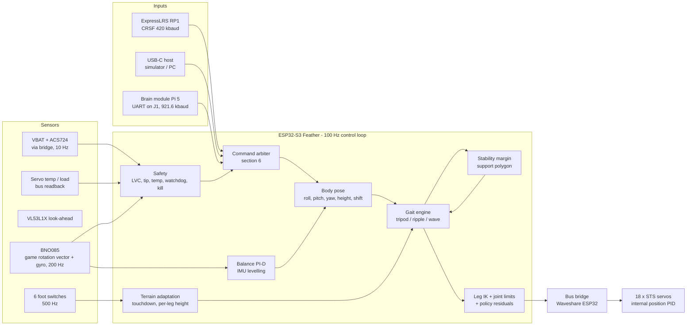

# Hexapod Mk1 (rev B2): control system

**On-board, not in the browser.** Everything needed to stand, walk, balance and cope with uneven ground runs on the robot's own microcontroller. The simulator, the radio and the brain module only send *commands* or small *corrections*, and the robot stays safe if any of them goes quiet.

| Item | Where |
| --- | --- |
| Firmware | [firmware/hexapod_controller](../firmware/hexapod_controller) (Feather ESP32-S3) and [firmware/bus_bridge](../firmware/bus_bridge) (Waveshare servo board) |
| Host tests | [firmware/test/test_core.cpp](../firmware/test/test_core.cpp): IK, gait invariants, stance window, stability margin, balance on a slope, CRSF round trip. All pass on the PC (g++). |
| Status | The structure is complete and the control maths is tested on the PC and in MuJoCo ([autonomy/mujoco](../autonomy/mujoco)). It has **not yet run on hardware**: tune it on the stand first (§10). |

## 1. Block diagram



## 2. Controller hardware and why

The rev B Waveshare *Servo Driver with ESP32* exposes only its I²C header (GPIO21/22) and one LED pin (GPIO23). The rest is used by the servo bus, the OLED and USB. That is not enough for:
- a CRSF receiver UART (2 pins);
- six foot switches (6);
- an IMU interrupt and reset (2);
- the attachment port's two AUX lines (2);
- the sonar (2).

So rev B2 splits the job:

| Board | Job | Why |
| --- | --- | --- |
| **Adafruit Feather ESP32-S3** (#5323 / #5477, $17.50) | Main controller: everything in this document | ESP32-S3 at 240 MHz with a single-precision FPU (IK for 18 joints takes about 40 µs). Native USB-C plus 3 UARTs. 21 usable GPIO. STEMMA QT I²C. Official STEP model (Adafruit_CAD_Parts, MIT). Same Arduino toolchain as rev B. |
| **Waveshare Servo Driver with ESP32** (kept) | Servo-bus co-processor: a transparent 1 Mbaud UART bridge on GPIO21/22, plus battery ADC | Keeps its proven half-duplex bus circuit and DC input. The bridge adds about 10 µs per byte. |

### Pin and bus budget (Feather ESP32-S3)

| Function | Pins (Feather label) | Bus / rate |
| --- | --- | --- |
| Servo bus via the bridge | TX, RX | UART1 1 Mbaud |
| ELRS receiver (CRSF) | D11 → RX pad, D12 ← TX pad | UART2 420 kbaud |
| Brain module (or weapon fire/aux) | A2 (AUX1), A3 (AUX2) on J1 | UART0 921.6 kbaud, or GPIO |
| BNO085 IMU | SDA, SCL (STEMMA QT); MOSI = INT, MISO = RST | I²C 400 kHz, address **0x4A** |
| VL53L1X look-ahead | SDA, SCL | I²C address **0x29** |
| Optional INA228/INA226 (§11) | SDA, SCL | address 0x40 (free) |
| Foot switches 0–5 | D5, D6, D9, D10, SCK, A4 (INPUT_PULLUP, switch to GND) | 500 Hz poll |
| HC-SR04 | A0 trig, A1 echo (10k/20k divider) | — |
| Host link | native USB-C (CDC) | 115200+ |
| Status LED | D13 | — |
| **Spare** | A5, BOOT (GPIO0) | for the next sensor |

All 21 GPIO are accounted for. The I²C bus has room for more devices (addresses 0x4A, 0x29, 0x40 used).

## 3. Servo level (inside each STS servo)

Each Feetech STS3215 / STS3250 runs its own position PID at about 1 kHz on a 12-bit magnetic encoder. The controller sends targets with `SyncWritePosEx`: one 1 Mbaud packet carries 18 positions, speeds and accelerations, about 1.5 ms on the wire.

| Register (ST/STS memory map) | Address | Walk (stiff) | Terrain / climbing (soft) | Notes |
| --- | --- | --- | --- | --- |
| Position P gain | 21 | **32** (factory) | **16** | Lower P lets a leg yield a little when it lands early, instead of fighting the other legs |
| Position D gain | 22 | **32** | **24** | Keeps damping when P is lowered |
| Position I gain | 23 | **0** | 0 | Leave at 0: the body controller removes steady errors |
| Goal speed | 46 | 2400 steps/s (600 for the first 2 s) | 1600 | Soft start on arming |
| Acceleration | 41 | 60 | 40 | — |
| Torque limit | 48 | 1000 (100 %) | 700 | Limits stall current per servo (wiring, WIRING.md §3) |

- **Register addresses.** Addresses 21 and 22 match the ST-servo memory table ([Waveshare memory map](https://docs.waveshare.com/Memory_Map_Explanation/ST_Servo_Memory_Map_Explanation), [st3215 crate](https://docs.rs/crate/st3215/latest/source/src/registers.rs)). Address 23 (I) appears in the RSBL/CF tables. **Read the registers back on your servos before writing them.** EEPROM writes need unlock (55) → write → lock.
- **When to soften.** Switch to the soft set when terrain mode is on (radio SD, or `C,` flag bit 0). Feet then land on unknown heights, and stiff servos would spike current and rock the body.

## 4. Leg kinematics (identical to the simulator)

**Frames.** The body frame is the simulator's: +X left, +Y up, +Z forward, origin at the coxa-joint height. Leg frame: +X out from the coxa along the splay, +Y up, +Z forward.

**Lengths.** a = 45 mm (coxa), f = 75 mm (femur), t = 120 mm (tibia, to the floor including the boot).

For a foot target (x, y, z) in the leg frame:

```
coxa  = atan2(z, x)
h     = sqrt(x² + z²) − a                   horizontal femur-axis → foot
d     = clamp( sqrt(h² + y²), d_min, f + t )  d_min = max(|f−t|, k_min)
femur = atan2(y, h) + acos( (f² + d² − t²) / (2 f d) )     + = up
tibia = acos( (f² + t² − d²) / (2 f t) ) − π                0 = in line, −90° = vertical
k_min = sqrt(f² + t² − 2 f t cos(π + tibia_min)) = 85.4 mm  (tibia_min = −135°)
```

- **Joint limits** (sim degrees): coxa ±45, femur −10…+70, tibia −135…+30. When the femur is below horizontal the tibia may only fold to −132 (`tibiaFoldWhenFemurDown`).
- **Lift cap.** A lifted foot close to the body would need the tibia folded past −135°. The gait caps the lift there: y ≤ −sqrt(k_min² − h²).
- **Servo map** (as `legToServo()`): deg = 90 + dir·angle + trim, tibia deg = 90 + dir·(tibia + 90°) + trim. Then step = 2048 + (deg − 90)·4096/360.
- **Policy residuals.** These are added after IK: `R,` lines, ±15° per joint, ignored after 100 ms and while the radio drives. The result is re-clamped to the joint limits.

## 5. Gait engine

| Gait | Leg phase offsets (FR, MR, RR, FL, ML, RL) | Swing fraction β | Feet always down | Use |
| --- | --- | --- | --- | --- |
| Tripod | 0, ½, 0, ½, 0, ½ | ½ | 3 | Flat ground, speed |
| Ripple | ⅔, ⅓, 0, ⅙, ⅚, ½ | ⅓ | 4 | Uneven ground, slopes, with the brain or a heavy attachment |
| Wave | 2/6, 1/6, 0, 5/6, 4/6, 3/6 | ⅙ | 5 | Climbing, maximum stability |

**Swing and stance per leg.** Each leg has a local phase φ ∈ [0, 1); the leg swings while φ < β.

- **Command filter** (same as the sim): v ← v + (v_cmd − v)(1 − e^(−8·dt)).
- **Velocity at each foot:** with ω = yaw rate,

  ```
  v_foot = (vx + ω·n_z, vz − ω·n_x)
  ```

  where (n_x, n_z) is the leg's neutral foot point.
- **Half stride:**

  ```
  half = v_foot · T_stance / 2,   T_stance = (1 − β) / f_step
  ```

- **Swing** (u = φ/β):

  ```
  s    = 2·(3u² − 2u³) − 1        (smoothstep)
  lift = sin(π u) · step_height · activity
  ```

- **Stance** (u = (φ − β)/(1 − β)):

  ```
  s    = 1 − 2u
  lift = 0
  ```

- **Foot target:**

  ```
  foot = neutral + half·s
  y    = −height + ground_offset[leg] + lift
  ```

**Neutral foot.** Mount + 100 mm along the splay; mounts and splay as in `hexapod.config.js`.

**Defaults.**
- Step frequency 1.7 Hz walking, 2.6 Hz sprinting.
- Step height 25 mm walking, 45 mm in terrain mode (with the body at 105 mm).
- Commanded top speeds 0.26 m/s walking, 0.48 m/s sprinting, 1.6 rad/s turning. **The stance-window rule below caps the real straight-line speed at about 0.13–0.16 m/s** with `footReach` 100 mm and the 80–115 mm window, so sprint barely helps. Going faster needs a wider window (bigger servos) or a longer neutral reach.

**Stance-window rule** (the load check, `cad/load_calc.py`). Every stance foot must stay **80–115 mm** from its coxa axis.
1. For each leg, compute the radial excursion of the stride end points.
2. If any leg leaves the window, first raise f_step, up to the sprint rate.
3. If that isn't enough, scale the body velocity down by the worst leg's ratio.

The test at full sprint plus turning holds 86–115 mm.

**Transitions.** The gait type only changes at a phase boundary where all feet are down. When the robot stops, it finishes the current swing and parks with all six feet down.

**Activity.** The legs keep stepping while |v| > 0.004 (yaw weighted 0.15). The activity value fades in and out over 0.2 s.

## 6. Command sources and arbitration

| Priority | Source | When it drives |
| --- | --- | --- |
| 0 | **Safety** (§9) | Always wins: kill switch, low battery, tipped |
| 1 | **Radio (CRSF)** | While the link is up (a frame within 250 ms). Its **ARM** switch arms the robot, and its **mode** switch picks manual / pose / auto |
| 2 | **Brain module** (`C,` / `R,` on J1) | Only in radio **auto** mode with the sticks centred. Any stick input hands control back to the radio at once |
| 3 | **USB host** (simulator / PC) | In radio auto mode when no brain is talking, **or** with no radio at all (tethered testing, armed by `A,1`). Joint-bridge `S,` lines are accepted the same way |

- **Radio lost.** After the radio has been used, losing it means: the robot stops and crouches to 60 mm, then relaxes after 2 s.
- **No autonomy without a radio.** The brain can never drive without a radio link, because the radio is the e-stop.

### Host and brain line protocol (USB and J1 UART)

**Unchanged from rev B:**
- `S,d0,…,d17[,aux…]`: joint bridge, servo degrees 0–180, 25 Hz.
- `B,<mV>,<mA>,<°C>,<OK|LOW|NOLINK>` at 2 Hz (robot → host).

**New in B2:**

| Line | Direction | Meaning |
| --- | --- | --- |
| `C,vx,vz,yaw,roll,pitch,height,gait,flags` | to robot | **Command mode**: m/s, m/s, rad/s, deg, deg, m, gait 0/1/2. Flags: bit 0 terrain, bit 1 fire, bit 2 sprint. The robot does its own gait, balance and terrain work. Send at ≥ 5 Hz (500 ms timeout). |
| `R,r0,…,r17` | to robot | Learned-policy residuals in degrees, 50 Hz (AUTONOMY.md §6) |
| `A,0` / `A,1` | to robot | Disarm / arm (USB only, and only when no radio is linked) |
| `T,roll,pitch,yaw,feet,margin_mm,mode,source,lq` | from robot | 10 Hz: attitude (deg), foot-switch bitmask, stability margin, mode (0 relaxed, 1 stand, 2 walk, 3 joint bridge), source (0 none, 1 RC, 2 host, 3 brain), radio link quality |

## 7. Body pose, balance and stability

### Pose
**Request.** Roll, pitch and yaw (±15° / ±15° / ±20°), height 60–110 mm, and a shift of ±25 mm.

**How the body moves.** Feet stay put on the ground. Each foot target is transformed from the level frame into the posed body frame before IK, with R = R_y(yaw)·R_x(pitch)·R_z(roll):

```
p_body = Rᵀ · (p_foot − shift)
```

So roll, pitch and height come from moving the **femur and tibia joints of all stance legs** together. Yaw and shift also use the coxa.

### Balance (IMU levelling): PI on attitude, D on the gyro
Measured: φ, θ (roll, pitch from the BNO085 game rotation vector) and the gyro rates ω_φ, ω_θ. Target: the requested pose φ*, θ* (0 = level in the world).

```
e_k   = φ* − φ_k
I_k   = clamp(I_{k−1} + e_k·dt, ±I_max/Ki)        (I_max = 10°)
D_k   = D_{k−1} + (−ω_φ,k − D_{k−1})·(1 − e^(−2π·8Hz·dt))    (derivative on measurement, 8 Hz low-pass)
u_k   = Kp·e_k + Ki·I_k + Kd·D_k
out_k = out_{k−1} + clamp(u_k − out_{k−1}, ±60°/s·dt)       (slew limit)
out_k = clamp(out_k, ±10°)                          (levelling limit, §8)
commanded body roll = φ* + out_k
```

The same law runs for pitch.

**Starting gains:** Kp = 0.6, Ki = 2.0 /s, Kd = 0.05 s, I_max = 10°, output limit ±10°, at 100 Hz.

**Why this form.**
- With the feet on the ground, the body's world attitude is the ground slope plus the commanded body tilt. So the loop is first order: e(1 + Kp) = −slope − Ki∫e.
- The time constant is (1 + Kp)/Ki ≈ 0.8 s. A 12° slope levels to 0.05° in 4 s (host test).
- The D term damps rocking from the gait and from recoil.

**Feed-forward.** The requested pose is sent straight to the pose, so the PI only corrects the error.

### Static stability margin

**Definition.**
- **Support polygon:** the stance feet, ordered counter-clockwise round their centroid.
- **Margin:** the shortest signed distance from the centre-of-mass (CoM) ground projection to the polygon's edges.
- **CoM projection:** (h·tan(roll), −h·tan(pitch)) for CoM height h, plus the attachment offset if one is known.

**Values on flat ground.**
- 6 feet: 167 mm.
- Tripod (neutral): 83 mm.

**Rule.**
1. If margin < **25 mm**, switch tripod → ripple (four feet down), and keep the pose controller from tilting further.
2. If margin < 0, raise a `UNSTABLE` fault: stop, crouch, then relax.

**Attachments.** The arm reaching out moves the CoM by m_a·r/M. A 0.4 kg load at 150 mm on a 3.36 kg robot moves it 18 mm, so the tripod margin stays above 25 mm (83 − 18 = 65 mm). Turret recoil from a foam-ball launcher is an impulse under 0.05 N·s and is absorbed by the D term.

## 8. Uneven terrain (terrain mode)

**What turns on.** Radio switch SD, or flag bit 0 in `C,`. That enables:
- body height 105 mm;
- step height 45 mm;
- the soft servo set;
- ripple gait recommended.

**Touchdown handling.** Touchdown heights are taken in the **true level frame**: the foot's posed body-frame position (after the lift cap) rotated by the IMU's measured roll and pitch. Using the commanded frame instead makes a body that isn't where it was told to be learn its own tilt into the ground offsets: front feet "find" higher ground, rear feet search lower, and the tilt grows. The sim found this; host test `test_touchdown_attitude`.
1. **Touchdown detection.** Each foot has a sealed Omron D2F micro-switch under the TPU boot, which closes when the boot carries more than about 1.5 N. It is read at 500 Hz and debounced over 2 samples.
2. **Early contact** (switch closes in the last 20 % of the swing). Stop the descent there and store the leg's ground offset: `ground[leg] = foot_y + height`. The leg then walks on that level.
3. **Late contact** (no switch by the planned touchdown). Keep lowering at 0.15 m/s for up to **131.6 mm − body height** (the step-down limit, at most 50 mm), then accept the position.
4. **Terrain following.** The body height follows the mean ground offset of the stance feet (time constant 0.7 s) and the offsets are re-centred, so the body rides parallel to the ground.
5. **Look-ahead.** The VL53L1X on the front bracket looks 30° down and reports the ground about 150 mm ahead. The brain uses it to slow down before drops; it is reported in telemetry, and the firmware gait doesn't depend on it.

### Limits from the geometry
Maximum foot lift, bounded by the tibia fold limit and the femur's +70° limit:

| Body height | at 80 mm reach | 100 mm | 115 mm | 130 mm |
| --- | --- | --- | --- | --- |
| 90 mm | 12 mm | 25 mm | 41 mm | 56 mm |
| 100 mm | 22 mm | 35 mm | 51 mm | 66 mm |
| 110 mm | 32 mm | 45 mm | 61 mm | 76 mm |

| Limit | Value | Basis |
| --- | --- | --- |
| **Step up** | **40 mm** (terrain mode, 105 mm height) | Swing lift 45 mm at 100 mm reach, with 5 mm clearance |
| **Step down** | **≈ 27 mm** at the 105 mm terrain height, **≈ 42 mm** at 90 mm | With the femur limited to −10° the deepest foot is 131.6 mm below the coxa axis at 100 mm reach (133 mm at 115 mm). Step-down = 131.6 mm − body height. Lower the body before going down a step. Allowing the femur below −10° would need a new collision sweep |
| **Belly clearance** | 51 mm at 90 mm height, 66 mm at 105 mm | Lowest part: coxa bracket 38.5 mm below the coxa joint |
| **Slope, static** | 29° (tripod), 42° (ripple), with a 25 mm reserve | Margin minus the CoM shift h·tan θ, h ≈ 105 mm |
| **Full levelling** | **≈ 10°** (best at about 98 mm body height) | Uphill feet can't come closer than about 65 mm below the coxa axis (tibia fold limit), downhill feet can't go deeper than 131.6 mm. Feet are about 170–180 mm from the body centre, so (131.6 − 65)/2 ≈ 180·tan θ gives θ ≈ 10°. The balance output is clamped at ±10° so the integrator doesn't wind up against the joint limits |
| **Slope, rated** | **20°**, body levelled to slope − 10° | Static stability still holds (above). On 10–20° slopes the body leans by the excess |

### Fallen or tipped
**Detection.** |roll| or |pitch| > 35°, or margin < 0 for 0.3 s.

**Response.**
1. Torque off (limp), so the robot doesn't thrash.
2. Raise a `TIPPED` fault and send it to the radio and the host.

**Recovery.** It is manual by default: put it back on its feet, disarm, re-arm. The brain module may run a scripted self-righting (lie flat, fold legs, push with one side). That is not enabled in the firmware.

## 9. Safety

| Hazard | Detection | Action |
| --- | --- | --- |
| Kill switch (radio SF) | Channel 10 high | Torque off immediately |
| Low battery | VBAT < 10.2 V for 3 s (recovers at 11.0 V) | Servos relax; motion ignored; `LOWBAT` to the radio, `B,…,LOW` to the host |
| Radio link lost | No CRSF frame for 250 ms | Fall back to the next source. With none, stop, crouch to 60 mm, relax after 2 s |
| Host / brain silent | No line for 500 ms | Its commands expire. The joint bridge relaxes (as rev B) |
| Tipped | IMU > 35°, or margin < 0 | Torque off, `TIPPED` |
| Hot servo | Temperature ≥ 65 °C (warn) / 75 °C (stop), one servo read every 110 ms | Warn, then relax and `HOT` |
| Overload or stall | Per-leg 3 A PTC fuses (WIRING.md); servo torque limit register | Hardware trips; the firmware's soft set limits torque |
| Firmware hang | ESP32 task watchdog (Arduino core, 5 s) and the bridge's 0.5 s link timeout | Reset → servos boot limp |

## 10. Loop rates and timing (ESP32-S3 at 240 MHz, one core)

| Task | Rate | Time per run | Load |
| --- | --- | --- | --- |
| Control (arbitrate, balance, gait, 18 × IK, limits) | 100 Hz | ≈ 0.15 ms | 1.5 % |
| SyncWritePosEx, 18 servos (152 bytes at 1 Mbaud, through the bridge) | 100 Hz | ≈ 1.6 ms (UART TX in hardware, about 0.1 ms CPU) | 1 % |
| CRSF parse (16 ch at 150 Hz) and telemetry (3 frames at 20 Hz) | 150 / 20 Hz | < 0.05 ms | < 1 % |
| BNO085 (SH-2 over I²C, two reports) | 200 Hz | ≈ 0.4 ms | 8 % |
| Foot switches | every loop pass (≥ 500 Hz) | < 5 µs | — |
| VL53L1X | 40 Hz | 0.2 ms | < 1 % |
| Battery query to the bridge | 10 Hz | ≈ 0.2 ms | < 1 % |
| Servo temperature (one servo) | 9 Hz | ≈ 0.3 ms | < 1 % |
| USB / J1 line parsing and telemetry | 25–50 Hz in, 10 Hz out | < 0.1 ms | < 1 % |
| **Total** | | | **≈ 15 %** of one core. The second core is free (Wi-Fi is not used) |

**Latency** from a radio stick to the servo target is under 20 ms: CRSF 6.7 ms at 150 Hz, plus one control period of 10 ms, plus 1.6 ms on the bus.

## 11. Sensor choices

| Need | Choice | Alternatives considered | Why |
| --- | --- | --- | --- |
| Body attitude | **BNO085** (Adafruit #4754, $25) in the IMU pod under the belly, about 15 mm from the CoM, on TPU grommets | ICM-42688-P (raw IMU, best noise, needs our own fusion); BNO055 (older fusion, more drift) | Fusion runs on the chip. The **game rotation vector** (gyro + accelerometer, no magnetometer) has no heading jumps near motors and steel, and a few °/min yaw drift. Roll and pitch are drift-free because gravity-referenced. Interrupt-driven, 400 Hz capable. Official STEP. |
| Foot contact | **Omron D2F-01 micro-switch** in the tibia tip, sealed under the sliding TPU boot (1 mm travel, the nub absorbs over-travel) | FSR in the boot (analog, drifts, fatigues); servo load or current readback (no wiring, but 20–40 ms latency and noisy during swing acceleration) | Binary, fast (500 Hz), rated for millions of operations, independent of the bus. Servo load readback is kept as a cross-check for broken switches |
| Joint position | STS bus readback (12-bit magnetic encoder, 0.09°) | Analog-feedback servos | Free with bus servos |
| Battery | VBAT divider + ACS724 ±30 A (in the main power path), read by the bridge's ESP32 | INA226 / INA228 shunt monitor on I²C | The ACS724 is isolated and already sized for 25 A peaks. An INA226 needs a 2 mΩ shunt in the 14 AWG main lead. The I²C address 0x40 is reserved in case you'd rather have one |
| Terrain ahead | **VL53L1X** (Pololu #3415, $13), 30° down on the front bracket | HC-SR04 (kept for obstacles), LD19 LiDAR (brain module) | 4 m range, 27° field of view, I²C, tiny, official STEP |

Wiring for every sensor is in [WIRING.md](WIRING.md); parts and prices are in [ELECTRONICS.md](ELECTRONICS.md).

## 12. Tuning procedure (robot on a stand, then on the floor)

1. **Bus check.** Flash `bus_bridge` to the Waveshare board and `hexapod_controller` to the Feather. With the robot on the stand (feet free), power up. The `T,` lines should show source 0 and the `B,` lines a sensible voltage.
2. **Directions and trims.** Send `S,` frames from the simulator, the rev B procedure (BUILD.md). Fix `DIR` and `TRIM` in `config.h` **and** in `hexapod.config.js`.
3. **IMU sign check.** Tilt the robot by hand: `T,` roll must be + when the left side goes up, and pitch + when the nose goes up. If not, change the axis mapping in `readImu()`.
4. **Feet.** Press each boot: its bit in `T,…,feet` must set (bit 0 = front-right … 5 = rear-left).
5. **Stand.** Arm on the radio in manual mode with the throttle in the middle. The robot should rise over 2 s (soft start).
6. **Balance gains.**
   1. Set Ki = 0 and Kd = 0 and raise Kp from 0.2 until the body levels a 10° board with a small overshoot.
   2. Then add Ki until the remaining error goes in about 1 s (start at 1.0, the target is about 2.0).
   3. Then add Kd until rocking at the step frequency stops (0.02–0.08).
   4. If the body oscillates at 2–5 Hz, halve Kd and lower the D low-pass to 5 Hz.
7. **Gait.** Walk slowly (tripod), then sprint. Watch the margin in `T,`: it must stay > 25 mm. If feet scuff, raise the step height. If the body bounces, soften the servos one step (P −4).
8. **Terrain.**
   1. Put 20 mm and then 40 mm boards in the path in terrain mode (ripple gait).
   2. Check the early-contact offsets: the body must stay level and the feet must not slap.
   3. Then try a 15° ramp with balance on.

## 13. For the simulator (mirror these exactly)

1. **Kinematics.** The leg is unchanged: 3 DOF, a/f/t = 45/75/120 mm, sim joint conventions, limits coxa ±45 / femur −10…70 / tibia −135…30, and the coupled tibia limit −132 when the femur < 0.
2. **Gait.** Tripod as now, plus ripple and wave with the phase offsets and swing fractions in §5.
   - Step height 25 mm, and 45 mm in terrain mode at a 105 mm body height.
   - Apply the lift cap y ≤ −sqrt(85.4² − h²) mm, and the stance-window rule (feet 80–115 mm: raise f_step up to 2.6 Hz, then scale v).
   - Change gait only when all feet are down.
3. **Pose.** p_body = Rᵀ(p_foot − shift) with R = R_y(yaw)·R_x(pitch)·R_z(roll). Limits ±15° / ±15° / ±20°, height 60–110 mm.
4. **Balance.** The PI-D above with Kp 0.6, Ki 2.0, Kd 0.05, I_max 10°, output ±10°, a 60°/s slew limit and an 8 Hz D low-pass, on the simulated IMU's roll and pitch (game rotation vector: gravity-referenced, no yaw correction).
5. **Touchdown.** A contact closes when the foot's normal force > 1.5 N.
   - Early contact in the last 20 % of the swing: freeze, then ground[leg] = rotate(R_imu(roll, pitch, pose yaw), foot_body).y + height.
   - Late contact: descend at 0.15 m/s for up to min(50 mm, 131.6 mm − height).
   - Terrain following: height += mean(ground[stance])·min(1, 1.5·dt), then ground[i] −= the same amount.
6. **Stability rule.** The margin is the signed distance of the CoM projection, (h·tan roll, −h·tan pitch), to the stance polygon. Below 25 mm, use ripple; below 0, fault.
7. **Limits.** Step up 40 mm; step down 131.6 mm − body height (≈ 27 mm at 105 mm); full levelling ≈ 10°; slope 20° rated; tip at 35°.
8. **Sources.** The radio layout and the arbitration in §6 (see [radio/README.md](../radio/README.md)).
