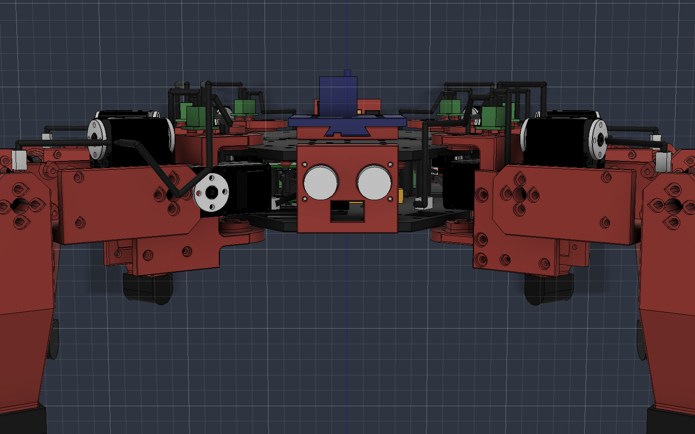

# Hexapod Mk1: mechanical design

This is the real robot that the simulator copies. The Fusion design **Hexapod Mk1** is generated by a script, so it can be rebuilt whenever a dimension changes:

| File | What it is |
| --- | --- |
| [cad/hexapod_mk1_fusion.py](../cad/hexapod_mk1_fusion.py) | Generator. Run it in Fusion (Utilities → Scripts, or through the Fusion MCP server). Builds every part, the assembly, user parameters and joints. |
| [cad/Hexapod_Mk1.f3d](../cad/Hexapod_Mk1.f3d) | Fusion archive of the generated design. Open with File → Open → Open from my computer. |
| [cad/stl/](../cad/stl/) | One STL per printed part, **already in print orientation** (bed face down, on Z = 0). |
| [cad/stl/print_sizes.json](../cad/stl/print_sizes.json) | Size, volume and bed-fit check for each STL. |
| [cad/orient_stl.py](../cad/orient_stl.py) | Turns Fusion's raw STL exports into print orientation and checks bed fit. |
| [cad/build_report.json](../cad/build_report.json) | Numbers the generator derived (servo pocket planes, arm positions, volumes). |
| [ELECTRONICS.md](ELECTRONICS.md) | Shopping list and wiring for everything that isn't printed. |
| [cad/mesh/](../cad/mesh/) | GLB meshes for the simulator, one per rigid moving group, in metres and sim axes (see §11). |
| [cad/export_sim_meshes.py](../cad/export_sim_meshes.py) | Converts per-body Fusion STL exports into those GLBs. |

Everything here is a first design that has not been built yet. Print the test coupons (see [Tolerances and calibration](#tolerances-and-calibration)) before committing to a full set of parts.

## 1. The design at a glance

- **Six identical legs.** Every leg uses the same Coxa, Femur and Tibia print. The left legs are the right legs rotated 180°, not mirrored, so you print 6 of each and nothing is handed. The firmware's `servos.direction` table already takes care of the mirrored servo directions.
- **Every joint is supported on both sides.** The servo horn drives one side. A 623ZZ bearing on an M3 bolt carries the other side, so the servo shaft is not the only thing holding the leg.
- **One fastener size:** M3, almost always into a brass heat-set insert. You never have to hold a loose nut.
- **Servos drop in from one direction**, into pockets that only accept them one way round. The tabs sit on a flat seat and four screws go straight down into inserts.
- **Body:** two 5 mm plates, 45 mm apart, on six M3 × 45 mm hex standoffs. Each plate is split in two so it fits a 220 mm bed. The halves lock together with T-shaped jigsaw keys. The seams are staggered (top plate at Y = +20 mm, bottom plate at Y = −20 mm), so each plate bridges the other plate's seam.
- **Modular top deck:** a 20 mm grid of M3 inserts, a dovetail quick-release receiver with an alignment key and a lock screw, a cable pass-through, and a connector bay for power + I²C + servo signals.

### Coordinate frames

| | +X | +Y | +Z |
| --- | --- | --- | --- |
| Fusion (this design) | robot right | forward | up |
| Simulator (three.js) | robot left | up | forward |

So `X_fusion = −x_sim`, `Y_fusion = z_sim`, `Z_fusion = y_sim`. The origin is the body centre, half way between the plates.

### User parameters (Fusion → Modify → Change Parameters)

The names follow [hexapod.config.js](../src/robots/hexapod.config.js) (`body.plateGap` → `body_plateGap`, `mounts[2][0]` → `mounts_2_x`, and so on). Change a value, run the generator again, and update the config so the simulator stays the twin.

| Parameter | Value | Notes |
| --- | --- | --- |
| `body_length`, `body_width` | 260, 140 mm | Core hexagon, same formula as the sim |
| `body_thickness`, `body_plateGap` | 5, 45 mm | |
| `body_lobeRadius` | 21 mm | **New.** Plate lobe round each coxa axis |
| `leg_coxa`, `leg_femur`, `leg_tibia` | 45, 75, 120 mm | Joint to joint. Tibia is measured to the floor and includes the 3 mm TPU boot |
| `mounts_i_x/z`, `legSplay_i` | as config | Coxa axis positions and splay |
| `topMount_y/z`, `frontMount_y/z` | 13, −10 / −12, 135 mm | Attachment datums (changed, see §9) |
| `fit_clearance` | 0.25 mm | Per side, servo pockets |
| `slide_clearance` | 0.2 mm | Per side, dovetail and jigsaw seams |
| `insert_hole` | 4.0 mm | Pilot hole for M3 × 5 × 4 inserts (see §4) |
| `clear_hole` | 3.4 mm | M3 clearance |
| `bearing_pocket` | 10.1 mm | 623ZZ press fit |
| `horn_pcd` | 18 mm | Bolt circle of the 25T aluminium horn. **Measure yours** |
| `first_layer_chamfer` | 0.5 mm | Elephant-foot chamfer |
| `root_fillet` | 3 mm | Load-path inside corners |

### Joints and range of motion

All 18 joints are as-built revolute joints named `Leg<n> coxa/femur/tibia`. They are grouped so each leg segment moves as one rigid group. The limits come from an interference sweep in Fusion, which moved each joint until a part collided. In Fusion's sign convention, +femur is down and +tibia folds in toward the body.

| Joint | Free range | Limited by |
| --- | --- | --- |
| Coxa | ±60° checked, set to ±45° | Gait never needs more |
| Femur | 90° up, **35° down** | The femur's tibia-servo cradle reaches the bottom of the coxa's femur-servo cradle |
| Tibia | 120° out, **45° in** (55° with the femur raised 40°) | The tibia shank reaches the femur cradle |

The standing pose (femur level, tibia vertical) sits well inside these ranges. So does a normal walking step (femur 20–40° up, tibia ±30°). The 35° femur-down limit only matters if the gait tries to raise the body more than about 40 mm above the stand pose.

## 2. Parts

### Printed parts

Volumes come from Fusion. Mass assumes PLA at 1.24 g/cm³ with about 60 % effective fill (3–4 walls, 4–5 top and bottom layers, 25–40 % gyroid); most leg parts are thin enough to be nearly all walls. Print times are rough: "classic" means an Ender-3-class printer at about 12 g/h, "fast" means a Bambu A1 / Prusa MK4 at about 30 g/h.

| Part | Qty | Material | Print orientation | Size as printed (mm) | ≈ g each | ≈ time each (classic / fast) | 220 bed | 180 bed |
| --- | --- | --- | --- | --- | --- | --- | --- | --- |
| Plate_Top_Front | 1 | PLA or PETG | Flat, bottom face down | 173 × 123 × 5 | 55 | 4.6 h / 1.8 h | ✓ | ✓ |
| Plate_Top_Rear | 1 | PLA or PETG | Flat | 202 × 151 × 5 | 73 | 6.1 h / 2.4 h | ✓ | **✗** |
| Plate_Bottom_Front | 1 | PLA or PETG | Flat, bosses up | 202 × 151 × 9 | 87 | 7.3 h / 2.9 h | ✓ | **✗** |
| Plate_Bottom_Rear | 1 | PLA or PETG | Flat | 173 × 123 × 5 | 62 | 5.1 h / 2.1 h | ✓ | ✓ |
| Coxa | 6 | **PETG** | On its flat back (the face away from the horn) | 73 × 90 × 39 | 38 | 3.1 h / 1.3 h | ✓ | ✓ |
| Femur | 6 | **PETG** | On its side (flat −Z face) | 108 × 61 × 26 | 37 | 3.1 h / 1.2 h | ✓ | ✓ |
| Tibia | 6 | **PETG** | On its side (flat −X face) | 129 × 61 × 24 | 50 | 4.2 h / 1.7 h | ✓ | ✓ |
| FootBoot_TPU | 6 | TPU 95A | Open end down | 28 × 22 × 23 | 5 | 0.4 h / 0.2 h | ✓ | ✓ |
| BatteryTray | 1 | PETG | Floor down | 58 × 112 × 30 | 22 | 1.8 h / 0.7 h | ✓ | ✓ |
| ControllerCarrier | 1 | PLA | Plate face down (upside down) | 54 × 74 × 8 | 6 | 0.5 h / 0.2 h | ✓ | ✓ |
| PowerPanel | 1 | PLA or PETG | Flat back down | 22 × 45 × 14 | 3 | 0.2 h / 0.1 h | ✓ | ✓ |
| FrontSensorBracket | 1 | PLA | Front face down | 50 × 55 × 19 | 6 | 0.5 h / 0.2 h | ✓ | ✓ |
| QR_Receiver | 1 | PETG | Base down | 60 × 78 × 8 | 19 | 1.6 h / 0.6 h | ✓ | ✓ |
| QR_AdapterPlate_Example | 1 per attachment | PETG | Plate face down, rail up | 70 × 62 × 11 | 21 | 1.8 h / 0.7 h | ✓ | ✓ |

**Robot total: about 1.1 kg of filament and 85 h on a classic printer (about 35 h on a fast one).** Plan on two 1 kg spools: PLA for the body, PETG for the legs and anything that carries load.

**Bed check.** Every part fits a 220 × 220 × 250 mm bed (Ender-3, Prusa MK4, Bambu A1). Only **Plate_Top_Rear** and **Plate_Bottom_Front** (202 × 151 mm) are too big for a 180 mm bed (Bambu A1 mini). For an A1 mini, add a second seam along X = 0 in the generator so those two halves split again. The jigsaw-key code can be reused.

### Material choice

- **PLA** is fine for the plates, the carrier, the bracket and the panel: stiff, easy to print, accurate. Keep the robot out of a hot car, because PLA creeps at about 50 °C.
- **PETG** is better for the coxa, femur, tibia, battery tray and quick-release parts. It is tougher, less brittle when the robot falls, and grips heat-set inserts better under constant servo load.
- **ASA** if the robot will work outdoors in the sun, or next to a hot UBEC.
- **TPU 95A** for the foot boots: grip and shock absorption.

### Print settings that matter

| Setting | Value | Why |
| --- | --- | --- |
| Layer height | 0.2 mm | |
| Walls | 4 for leg parts, 3 for everything else | Leg parts are mostly walls anyway, and the walls carry the load |
| Top / bottom layers | 5 / 4 | |
| Infill | 30–40 % gyroid for leg parts, 20–25 % for plates | |
| Supports | **None.** All parts are designed to print without them | |
| Brim | 5 mm brim on the tibia and the femur | Tall or narrow footprint |

## 3. Design for printing (DFM)

- **Flat print faces.** Each part has one big flat face that goes on the bed, and the STLs are exported in that orientation.
- **No supports.** Overhangs are 45° or steeper: the dovetail flanks are 56°, the tibia taper about 65°, and the femur and tibia roots are octagons instead of circles.
- **Teardrop holes.** Holes that run horizontal in the print (horn bolts, bearing pockets, the femur and tibia idler pockets) have a 45° teardrop roof that points up in the print. The bearing pocket's roof is not a bearing surface: the bearing seats on the bottom and sides.
- **Bridges.** The femur's tibia-servo pocket roof is a 41 mm bridge when printed on its side. That is fine on any tuned printer. If yours sags, print a bridging test first.
- **Elephant-foot chamfer.** Every bed-side edge has a 0.5 mm chamfer, added automatically by the generator on each part's bed face.
- **Fillets on load paths.** Inside corners that carry servo torque have 3 mm fillets. These are the coxa web to the arms and to the cradle, the femur risers, and the tibia arms to the bridge, the window and the foot. The plates have 4 mm fillets where the lobes meet the hexagon. The fillets are found automatically: the generator looks for concave edges along the part's extrusion direction before the holes are cut.
- **Clearances.**
  - Servo pockets: +0.25 mm per side.
  - Dovetail and jigsaw seams: +0.2 mm per side.
  - M3 clearance holes: 3.4 mm.
  - 623ZZ pockets: 10.1 mm, a press fit in PETG. Use 10.15–10.2 mm if your printer prints holes small.
- **Wall thickness:** 2.5–3 mm around servo pockets, at least 2 mm round every insert.

## 4. Design for assembly (DFA)

- **Unique parts:** 14 printed designs for the whole robot. The 18 leg parts are only 3 designs, plus the boot.
- **Fasteners:** M3 throughout. There are only two exceptions, both for bought boards whose holes are smaller: M2.5 self-tapping screws for the PCA9685 boards and M2 self-tapping screws for the HC-SR04.
- **Inserts:** M3 brass heat-set inserts, "M3 × 5 × 4" (Voron-style: 5 mm OD, 4 mm long), in a 4.0 mm pilot hole. Set them with a soldering iron at the filament print temperature plus about 10 °C. If you buy McMaster's tapered inserts (94180A331) instead, set `insert_hole` to the hole size on their drawing and run the generator again.
- **Idler stack** (outside → in): M3 × 12 button head → M3 washer (7 mm OD) → arm with a 7.4 mm counterbore → 623ZZ pressed into the arm → M3 washer → heat-set insert in the fixed part. The bolt clamps only the bearing's inner ring. The 7 mm washer clears the outer ring, so the joint turns freely, and you can tighten the bolt fully without binding it.
- **Self-locating features.**
  - Servos only fit their pocket one way: the shaft offset makes the case asymmetric, and the wire slot only lines up one way.
  - The jigsaw keys only fit their own seam.
  - The dovetail has an off-centre key, so an attachment can only slide in facing forward.
  - Each foot boot has a single open end.
- **Service access.** The battery slides in from the rear between the plates and is held by a 20 mm hook-and-loop strap through the tray's slots. You never need to remove a plate. The ESP32's USB port is reachable through a window in the front bracket.

### Hardware list

Off-the-shelf parts only. Prices and links are in [ELECTRONICS.md](ELECTRONICS.md#5-mechanical-hardware).

| Item | Qty needed | Buy | Used for |
| --- | --- | --- | --- |
| M3 × 5 × 4 brass heat-set insert | 137 | 200 | 90 leg (plate tabs 24, bottom idlers 6, coxa 30, femur 30), deck grid 23, sensor bracket 2, tray 4, carrier 6, panel 2, receiver lock 1, adapter 9 |
| M3 × 8 button head (ISO 7380) | 166 | 200 | Servo tabs 72, horn to arm 72, standoffs 12, receiver 4, bracket 2, tray 4 |
| M3 × 12 button head (ISO 7380) | 18 | 25 | Idler bolts |
| M3 × 10 button head | 4 | 10 | Controller carrier 2, power panel 2 |
| M3 × 10 thumb screw (knurled) | 1 per attachment | 5 | Quick-release lock |
| M3 washer, DIN 125 (7 mm OD) | 36 | 50 | Idler stacks |
| 623ZZ bearing (3 × 10 × 4) | 18 | 20 | Idlers |
| 25T aluminium round servo horn (≈25 mm) | 18 | 20 | Check the hole circle (`horn_pcd`) and that the horns are tapped M3 |
| M3 × 45 mm hex standoff, female-female | 6 | 10 | Plate spacers |
| M2.5 × 6 self-tapping screw | 8 | 10 | PCA9685 boards |
| M2 × 6 self-tapping screw | 4 | 10 | HC-SR04 |
| 20 mm hook-and-loop strap, 200 mm | 1 | 2 | Battery |
| Cable ties 2.5 mm wide | ~40 | 100 | Strain relief slots |

## 5. Assembly order

1. **Test coupons first** (§10). Check servo pocket fit, insert holes, the bearing press fit and the dovetail slide. Adjust the parameters if needed.
2. **Set all heat-set inserts** in every printed part, before anything else is assembled.
3. **Centre every servo.** Connect each servo to a PCA9685, send 90° (firmware or the simulator's stand pose), and label it.
4. **Bottom plate.** Join the two halves at the jigsaw keys. Glue the keys with CA if you like, because the standoffs and servos also hold the seam. Fit the six standoffs with M3 × 8 screws from below, then the battery tray, the two PCA9685 boards on their bosses, and the UBECs over the vent slots.
5. **Top plate.** Join the halves. Hang the controller carrier underneath with the perfboard (ESP32, 5 V buck, power distribution) already on it.
6. **Coxa servos.** Drop the six servos into the top plate from above. The wire end points inward and the case hangs between the plates. Screw down the tabs with 4 × M3 × 8 each.
7. **Close the body.** Lower the top plate onto the standoffs and screw it down. Route the 6 coxa leads to the PCA boards. Fit the power panel, then the front sensor bracket.
8. **Legs, coxa first.** Press a 623ZZ into each coxa's lower arm. Fit a horn on each coxa servo spline with the servo at 90° and the horn bolt pattern square to the leg direction. Fit the coxa: top arm to the horn with 4 × M3 × 8, lower arm with the idler stack into the bottom plate insert.
9. **Femur servos** into the coxa cradles, tabs on the +Y face, 4 × M3 × 8. Horn on at 90°. Press bearings into the femurs and fit the femurs: horn side to the horn, idler side with the idler stack into the coxa's back insert. Adjust so the femur is level at 90°.
10. **Tibia servos** into the femur cradles. Horn on, tibia on, idler stack. The tibia should hang vertical at 90°.
11. **Boots** onto the feet. Use a drop of CA if they slip.
12. **Wiring and strain relief.** Run each leg's femur and tibia leads along the coxa and into the body through the side gap. Zip-tie them through the slot pair next to each coxa axis, leaving a loop so the coxa can swing ±45°.
13. **Power check before servos.** No battery: check every rail with a bench supply. Then battery with the servo rail fuse out, then fuse in, with the robot on a stand (see BUILD.md).
14. **Trim.** Use `servos.trim` in the config ([BUILD.md](BUILD.md#calibration-trim)).
15. **Top deck.** Bolt on the QR receiver (4 × M3 × 8 into the grid at X ±20, Y −30/+10) and plug the J1/J2 pigtails into the connector bay.

## 6. Electronics bay

| Item | Where | Notes |
| --- | --- | --- |
| 2S LiPo (tray 37 × 27 × 112 mm inside) | Rear, on the bottom plate, slides out the back | Packs up to 35 × 26 × 110 mm fit. Check yours |
| 2 × UBEC (6 V) | Middle, over five vent slots in the bottom plate | Stack them with foam tape. Hot air goes up and out the open sides |
| 2 × PCA9685 | Front half of the bottom plate, on bosses | Servo headers face the sides, close to the leg leads |
| Controller perfboard (50 × 70) with ESP32 on headers, 5 V buck, VBAT divider, I²C and power distribution | Hangs under the front of the top plate | USB faces forward, through the front bracket window |
| Power switch, fuse | Rear power panel (switch) and inline (fuse) | |
| Cable pass-through | 30 × 14 mm slot in the top plate under the connector bay | Attachment pigtails |
| Leg-lead strain relief | Zip-tie slot pairs 36 mm inboard of each coxa axis in the bottom plate | |

## 7. Attachment interface (the top deck)

**Mechanical**

- **Grid:** M3 inserts on a 20 mm pitch, X = −20 / 0 / +20, Y = −70 … +70 (23 holes; one is left out for the cable slot). Anything can bolt straight to the deck.
- **Quick-release receiver** (bolted to the grid):
  - The dovetail slot runs front to back. It is 28 mm wide at the floor, 20 mm at the top and 6 mm deep, with a 2 mm floor and a 56° flank.
  - Attachments slide in **from the front** until they hit the rear stop wall.
  - An alignment key (4 × 2 mm) on the slot floor, 6 mm right of centre, makes it fit one way only.
  - Lock: an M3 thumb screw through the adapter plate into the insert at X = +24, Y = −36.
- **Adapter plate** (one per attachment): a dovetail rail (0.2 mm smaller per side, with the keyway) and a 70 × 62 × 5 mm plate with nine M3 inserts on the same 20 mm grid. Build each attachment on its own adapter plate.
- **Datum:** the top of the adapter plate is 13 mm above the top plate (Fusion `topMount_y`). The datum point is X = 0, Y = −10 mm.
- **Keep-out:** the coxa top arms sweep 17–22 mm above the top plate, out to X = ±26 mm (front and rear legs) and ±46 mm (middle legs). Anything wider than ±25 mm must sit at least 25 mm above the top plate.

**Electrical (connector bay behind the receiver)**

| J1: JST-XH 8-pin (power + bus) | | J2: JST-XH 6-pin (servo signals) | |
| --- | --- | --- | --- |
| 1 | GND | 1 | PWM ch 12 |
| 2 | GND | 2 | PWM ch 13 |
| 3 | V_SERVO 6 V | 3 | PWM ch 14 |
| 4 | V_SERVO 6 V | 4 | PWM ch 15 |
| 5 | +5 V logic | 5 | PWM ch 28 |
| 6 | 3V3 | 6 | GND |
| 7 | SDA (3.3 V, with pull-ups) | | |
| 8 | SCL (3.3 V, with pull-ups) | | |

PWM channels 12–15 and 28 are the firmware's `AUX_CHANNELS`: turret pitch, or arm base, shoulder, elbow, wrist and gripper.

**Power budget for one attachment**

| Rail | Limit | Protected by |
| --- | --- | --- |
| V_SERVO 6 V | 5 A continuous | 5 A blade fuse (or polyfuse) on the perfboard |
| +5 V | 1 A | Shared 3.2 A buck: ESP32 0.25 A + sonar 15 mA + LiDAR ≈ 0.3 A + attachment |
| 3V3 | 100 mA | ESP32 regulator |

Examples:

| Attachment | What it needs |
| --- | --- |
| Arm (5 × MG90S) | 2–4 A peak on V_SERVO |
| Toy laser (IR LED + red LED + MG90S pitch) | < 0.5 A |
| Foam-ball flywheel launcher | 2 × 130-size motors ≈ 2–3 A on V_SERVO, through a MOSFET driver on the adapter |
| LiDAR mast (RPLIDAR C1) | 5 V, about 0.3 A, plus UART (bring out a spare JST if needed) |

**Future generator or extra battery pack:** never back-feed J1. Connect a second pack on the VBAT side through an ideal-diode module (or a second XT60 in parallel with a matching pack) and change the fuse.

## 8. Weight and servo torque check

| Item | Mass |
| --- | --- |
| Printed parts (PLA/PETG, about 60 % fill) + TPU boots | 1 115 g |
| 18 × MG996R (55 g each) | 990 g |
| 18 aluminium horns, 18 bearings | 130 g |
| Screws, inserts, washers, standoffs | 150 g |
| 2S 2200 mAh LiPo | 130 g |
| Electronics (2 UBECs, ESP32, 2 × PCA9685, buck, switch, perfboard, sonar) | 130 g |
| Wiring, XT60, fuse | 60 g |
| **Total (no attachment)** | **≈ 2.7 kg** |

The old config estimate of 1.6 kg was too optimistic. The config now says 2.7 kg.

**Worst steady case: tripod gait, three feet on the ground.** Each foot carries m·g/3. The femur servo holds that load at the horizontal distance from the femur axis to the foot. In the stand pose that is footReach − coxa = 130 − 45 = 85 mm.

| Case | Moment arm | Femur torque | vs MG996R 11 kg·cm at 6 V (stall) |
| --- | --- | --- | --- |
| 2.7 kg, footReach 130 | 85 mm | 0.75 N·m = **7.7 kg·cm** | **70 %** |
| 3.0 kg (with 300 g attachment) | 85 mm | 8.5 kg·cm | 77 % |
| 2.7 kg, footReach 110 | 65 mm | 5.9 kg·cm | 53 % |
| 2.7 kg, DS3218 femurs (≈ 20 kg·cm) | 85 mm | 7.7 kg·cm | ≈ 38 % |

A hobby servo should run continuously at no more than about a third to a half of its stall torque. At 70 % the MG996R femurs will get hot, sag and draw close to stall current. The tibia carries much less: in the stand pose the foot is almost straight below the tibia axis. The coxa only fights friction and inertia, and its idler bearing takes the bending load.

**Recommendation (an open question for you):** use **DS3218MG (20 kg, 180° version) for the six femur joints**. It has the same 40 × 20 mm case and 25T spline, so it fits the same pockets with 0.1 mm per side. Check the tab height and the hole spacing on your servos against the MG996R numbers in the generator before printing. MG996R stays for the coxa and tibia joints. A narrower stance (footReach 110 mm) helps too, but it changes the gait, so that is a simulator decision.

## 9. Dimension changes made for buildability

| What | Before | Now | Why |
| --- | --- | --- | --- |
| Plate outline | Hexagon 260 × 161 mm | Hexagon + 21 mm lobes round each coxa axis. Overall **262 × 202 mm** | The coxa servo's outer tab screws sit 14–15 mm outboard of the axis and need plate under them. `body.lobeRadius: 0.021` added to the config, and the sim now draws the lobes |
| `body.massKg` | 1.6 | 2.7 | CAD estimate (§8) |
| `topMount` | `[0, 0.03, -0.01]` | `[0, 0.013, -0.01]` | Real quick-release datum is 13 mm above the top plate |
| `frontMount` | `[0, 0, 0.13]` | `[0, -0.012, 0.135]` | Sonar moved 12 mm down so the ESP32 USB port above it stays reachable |
| Leg lengths, mounts, splay, plate gap and thickness | | **Unchanged** | The legs were designed round the existing numbers |

The stand pose (femur level, tibia vertical) puts the belly (the bottom of the coxa lower arms) about 86 mm off the floor. That matches `standHeight: 0.09`.

## 10. Other things to consider

**Power budget and brownouts**
- Average walking current is roughly 4–8 A for 18 MG996R. Each one stalls at about 2.5 A at 6 V, so 45 A is possible if everything jams.
- Each UBEC feeds one PCA9685 board (9 leg servos + aux channels). One sagging rail can't take the other down, and **the ESP32 has its own 5 V buck straight from the battery**, so a servo surge can't reset it.
- Put a 1000–2200 µF, 10 V low-ESR capacitor on each PCA9685's V+ terminal (the Adafruit board has a footprint for it).
- In firmware, keep the PCA outputs disabled (OE high) until the first valid command. Then move legs one or two at a time to the stand pose, rather than all 18 at once.

**Battery safety**
- 2S LiPo: charge only on a balance charger, in a LiPo bag, attended.
- Stop at 3.5 V/cell under load (7.0 V for the pack). Read VBAT through a 100 k / 33 k divider on GPIO 34 and sit the robot down when it gets low.
- The 20 A main fuse protects the wiring. A 2200 mAh 60C pack can deliver over 100 A into a short.
- Unplug the XT60 when you're done. The tray strap stops the pack sliding out.

**Centre of gravity with attachments**
- The battery sits in the rear half, so the body CG is a little behind centre (weigh the built robot on two kitchen scales to find it).
- The deck datum is at Y = −10 mm, so mount heavy attachments (the arm, the launcher) as low and as close to the datum as you can.
- In a tripod gait the support triangle is narrowest along X. Keep the attachment CG within about ±30 mm of the centre line and below about 80 mm above the deck. A robot arm reaching out sideways is the most likely thing to tip it.

**Cable strain relief**
- Leave a service loop at each coxa and zip-tie it at the bottom-plate slots, so leg swings pull on the tie, not on the servo's solder joints.
- Use 30 cm servo extensions only where the stock leads are too short (the front and rear tibia servos).
- Keep the battery leads (14 AWG) away from the servo signal wires.

**Tolerances and calibration**
- Print a coupon first: a 30 mm block with one servo pocket corner, one insert hole, one bearing pocket and 30 mm of dovetail. Then adjust `fit_clearance`, `insert_hole` and `bearing_pocket` and re-run the generator.
- Servo dimensions vary between batches and clones. Measure one MG996R's tab height (26.6 mm from the bottom) and spline height (16.3 mm above the tab) and check them against the `MG996R` dictionary in the generator.
- After assembly, trim each joint in `servos.trim` (BUILD.md).

**Future upgrades**
- DS3218MG femurs (see §8).
- Second seam for the A1 mini.
- Foot contact switches in the boots, IMU (MPU-6050 / BNO085) on the perfboard for body levelling, and current sensing (INA226) on VBAT.
- A Mk2 coxa that mounts the femur servo case pointing up, which would give more femur-down travel.

**Cost:** about **US$525–555** for the whole robot (12 MG996R + 6 DS3218, branded boards, 2 kg filament, battery and charger), or about US$440 with all-MG996R servos and AliExpress boards. The itemised list is in [ELECTRONICS.md §7](ELECTRONICS.md#7-rough-total).

## 11. Meshes for the simulator

Files are in `cad/mesh/`. They were exported with every joint at 0 and converted by `cad/export_sim_meshes.py`. Units are metres, +Y is up, and bearings and fasteners are left out. Each file has one material per part.

| File | Triangles | Contents | Origin and axes |
| --- | --- | --- | --- |
| `body.glb` | 26.5k | Plates, standoffs, 6 coxa servos, battery tray + battery, UBEC, PCA9685s, controller carrier + perfboard + ESP32, power panel, sonar bracket | Body centre, half way between the plates (the femur-axis height). +Z forward, +X robot left |
| `coxa.glb` | 4.2k | Coxa + coxa horn + femur servo | On the coxa axis at femur-axis height. Leg along +X. Servo horn side is −Z |
| `femur.glb` | 3.8k | Femur + femur horn + tibia servo | On the femur axis. Link along +X, zero angle = horizontal |
| `tibia.glb` | 3.2k | Tibia + tibia horn + TPU boot | On the tibia axis. At zero angle the shank runs along +X and the boot touches at x = 0.120 m |
| `qr_receiver.glb` | 1.4k | QR receiver | Body frame |
| `qr_adapter_example.glb` | 2.4k | Adapter plate + MG90S | Body frame. Datum (top of the adapter plate) at y = 0.0405 m |
| `sonar_example.glb` | 0.6k | HC-SR04 | Body frame |

All six legs use the same three leg meshes, rotated by the mount yaw like the real parts. Nothing is mirrored.
