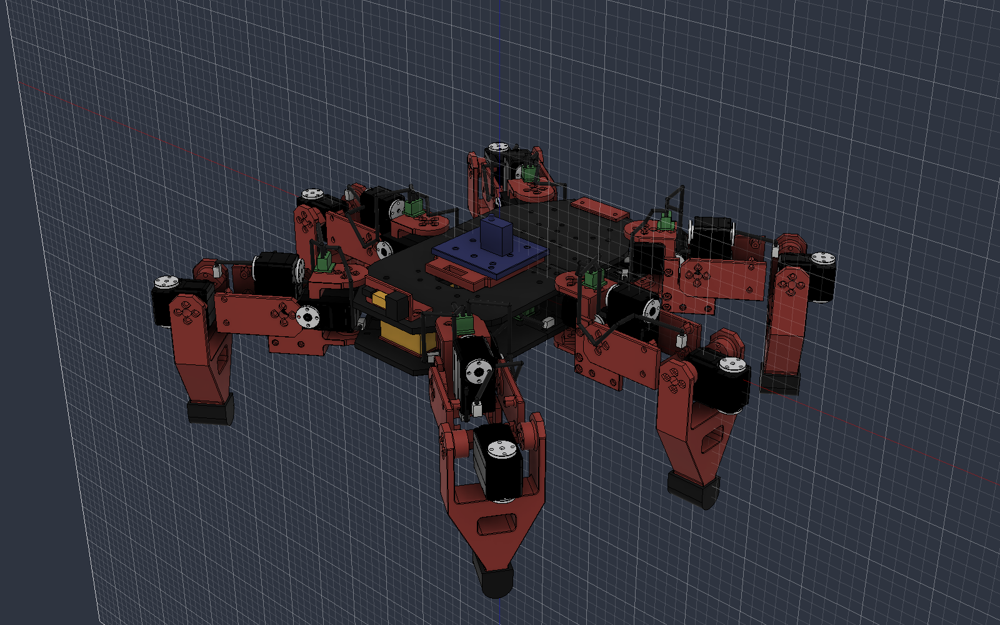

# Hexapod Mk1 (rev B): mechanical design

Rev B rebuilds Mk1 around **Feetech serial-bus servos** and a **3S LiPo power system**:

- STS3215 on the coxa and tibia joints, STS3250 on the femurs.
- The real manufacturer CAD is used for the servos and boards.
- Every wire, cable and connector is modelled.

Every printed part was redesigned around the measured servo geometry. Rev A (MG996R PWM servos and a 2S pack) is described in the [design notebook](notebook/), together with why it changed.

| File | What it is |
| --- | --- |
| [cad/hexapod_mk1_fusion.py](../cad/hexapod_mk1_fusion.py) | Generator. Run it in Fusion. It builds every part, the assembly, the wiring harness, user parameters, joints and limits. `build(use_vendor=True)` imports the vendor STEPs; `False` uses envelopes |
| [cad/vendor/](../cad/vendor/) | `fetch_vendor_cad.py` downloads the manufacturers' STEP files. [SOURCES.md](../cad/vendor/SOURCES.md) lists the sources and licences |
| [cad/Hexapod_Mk1.f3d](../cad/Hexapod_Mk1.f3d) | Fusion archive of the envelope build (no vendor geometry, see SOURCES.md). The build with the real models is the "Hexapod Mk1" design in the Autodesk cloud, Default Project |
| [cad/stl/](../cad/stl/) | One STL per printed part, in print orientation |
| [cad/mesh/](../cad/mesh/) | GLB meshes for the simulator |
| [cad/load_calc.py](../cad/load_calc.py) | Servo torque check (§3) |
| [cad/interference_sweep.py](../cad/interference_sweep.py), [cad/interference_report.json](../cad/interference_report.json) | Collision check of the whole assembly, harness included, at the joint limits (§4) |
| [ELECTRONICS.md](ELECTRONICS.md), [BUILD.md](BUILD.md) | Shopping list, wiring, charging, assembly |
| [notebook/](notebook/) | Engineering design notebook. Compile it with `python docs/notebook/build_notebook.py` |

## 1. Architecture

**One servo geometry everywhere.** The ST3215 / STS3215 (and the STS3250, which has the same 45.22 × 24.72 × 35 mm housing) has:

- an output horn on one face and a free-spinning idler disc on the opposite face, both Ø19.2 mm aluminium with 4 × M3 tapped holes on a 14 mm circle;
- M2 holes in the case faces;
- side-entry bus sockets on both long sides.

All of this was measured from the official STEP (in servo frame L: the output axis is +Z, the origin is on the axis half-way between the horn faces, and the case runs along +X):

| Feature | Value (frame L) |
| --- | --- |
| Case | x −10.11 … 35.11, y ±12.36 |
| Seating faces | top +13.825 (with a 2.7 mm label boss), bottom −16.575 (with a 1.9 mm pad) |
| Horn faces | ±18.625 |
| M2 holes usable beside the horn | top face x 29.0 y ±10.25; bottom face x 32.75 y ±10.25 |
| Bus sockets | side entry, x 13.9, z −8.5, on both long faces |

**The servo sandwich.** Every servo is clamped between two 5 mm printed faces that sit on its real seating faces, with pockets for the label boss and pad and 2 × M2 into the case on each side:

- the body plates for the coxa servos;
- the coxa bracket for the femur servo;
- the femur's arms for the tibia servo.

**Two-sided joints.** Every moving bracket bolts to the driven horn on one side and the idler horn on the other, through pads (4 × M3 each side). Each joint is therefore supported on both sides by the servo's own bearings. The rev A 623 bearings are gone.

| Link | Parts | Joint |
| --- | --- | --- |
| Body | 2 split plates with integral pillars (gap 30.4 mm = the servo case), battery tray, electronics | Coxa servos clamped between the plates, shaft vertical, case pointing inward. The plate edge sits 11.5 mm inside each coxa axis |
| Coxa | CoxaMain (top and bottom horn arms, web, + clamp plate) + CoxaCap (− clamp plate, 3 × M3) | Femur servo shaft horizontal, 45 mm out, case pointing down |
| Femur | One part: two horn arms with bosses that clamp the tibia servo, bridge underneath | Tibia servo 75 mm out, case pointing back along the femur |
| Tibia | One part: outboard horn arms (so the leg can fold), chamfered bridge, tapered shank, lightening window, foot | Foot contact 120 mm from the tibia axis, including the 3 mm TPU boot |

The joint-to-joint lengths are unchanged: **coxa 45, femur 75, tibia 120 mm**. All six legs use the same parts, rotated rather than mirrored.

## 2. Actuators

| Joint | Servo | Why |
| --- | --- | --- |
| Coxa × 6 | **Feetech STS3215 / Waveshare ST3215, 12 V, 30 kg·cm stall, 10 kg·cm rated** | Widely sold (the SO-100 arm uses them), official STEP, 12-bit magnetic encoder, position/load/voltage/temperature feedback for the digital twin |
| Femur × 6 | **Feetech STS3250, 12 V, 50 kg·cm stall, 16 kg·cm rated** | Same housing, horns, bus and protocol as the STS3215. Needed for the 2× rated-torque margin at the femur (§3) |
| Tibia × 6 | STS3215 | |
| Arm: base, shoulder, elbow | STS3215 | Shoulder needs 4.1 kg·cm (120 + 120 mm links, 50 g payload) → 2.4× rated |
| Arm: wrist, gripper; turret pan and pitch | **Feetech STS3032**, 6 V micro bus servo (4.5 kg·cm stall, 1.5 kg·cm rated) | Wrist 0.4 kg·cm → 4×; turret pitch 0.25 kg·cm → 6×. Runs from a 6 V buck on the attachment |

Rated and stall torques are the manufacturer and distributor figures (Feetech via RobotShop, DFRobot and Openelab; links in ELECTRONICS.md). The STS3250's 16 kg·cm rating comes from one distributor listing, so check it against the datasheet that ships with your servos. Budget option: all-STS3215. It works, but the femurs only have 1.3× rated margin (4× on stall), so they will run warm when carrying a heavy attachment.

## 3. Load check

**Case.** Tripod stance (three feet down) carrying the whole robot (2.86 kg, CAD estimate) plus the heaviest top attachment (0.4 kg). Each foot carries F = m·g/3 = 10.7 N.

**Stance limit.** The stance must stay inside the load envelope: every stance foot 80–115 mm from its coxa axis (`leg.footReachMin/Max` in the config, nominal `footReach` 100 mm). The uncapped gait (sprint + turn + strafe) can ask for feet out to 194 mm. That would need 16 kg·cm at the femur, and no affordable servo carries that at a 2× margin, so the gait must clamp foot targets to this ring (simulator task).

**How each torque is worked out** ([load_calc.py](../cad/load_calc.py)), with the coxa-joint height at 90 mm:

- **Femur:** F × the horizontal distance from the femur axis to the foot.
- **Tibia:** the worst value of F × the horizontal distance from the knee to the foot, anywhere in the ring.
- **Coxa:** a sideways push of 0.3 F at the widest reach.

| Joint | Servo | Required | Rated (12 V) | **Margin vs rated** | Margin vs stall |
| --- | --- | --- | --- | --- | --- |
| Coxa | STS3215 | 3.75 kg·cm (0.37 N·m) | 10 kg·cm | **2.67×** | 8.0× |
| Femur | STS3250 | 7.61 kg·cm (0.75 N·m) | 16 kg·cm | **2.10×** | 6.6× |
| Tibia | STS3215 | 3.90 kg·cm (0.38 N·m) | 10 kg·cm | **2.56×** | 7.7× |
| Femur (budget: STS3215) | STS3215 | 7.53 kg·cm | 10 kg·cm | 1.33× | 4.0× |
| Femur, rev A stance (feet to 176 mm), STS3215 | | 14.2 kg·cm | 10 kg·cm | 0.70× | 2.1× |

**Mass** (iterated with the real parts): printed 1.01 kg, bought parts 1.65 kg (12 × 69 g STS3215, 6 × 74.5 g STS3250, 305 g battery, boards), screws and inserts 0.11 kg, harness 0.09 kg. **Total 2.86 kg.**

## 4. Joint limits and collision check

[interference_sweep.py](../cad/interference_sweep.py) runs Fusion's interference analysis on the whole assembly, wiring harness included:

- at the neutral pose;
- with legs 0+1, 3+4 and 2+5 driven together through each joint's limits and the corner combinations.

Only intended contacts are filtered out: a cable end inside its own plug, a cable on its board terminal, and two segments of one cable meeting at a joint-axis splice. Result ([interference_report.json](../cad/interference_report.json)): **the neutral pose and every pose inside the limits are clean.**

| Joint | Limit (Fusion sign) | Limit (sim degrees) | Limited by |
| --- | --- | --- | --- |
| Coxa | ±45° | ±45° | Gait never needs more (clean to ±60° without cables) |
| Femur | 70° up / 10° down | −10 … +70 | Up: the hub-to-tibia lead meets the coxa at 90°. Down: the tibia meets the coxa side plate when it is also folded |
| Tibia | 120° out / 45° in | −135 … +30 | 45° in only while the femur is level or up; **42° (sim −132°) with the femur up to 10° down** (`tibiaFoldWhenFemurDown`) |

The gait's measured ranges (coxa −43…34, femur −4…64, tibia −135…−41) fit inside these limits apart from the single coupled corner.

## 5. Wiring harness (modelled)

Every cable is a routed pipe of the right diameter, and every connector is a body. Bus leads are 3.2 mm (Feetech 3-pin), 14 AWG power is 3.4 mm, signal is 1.6–2 mm. Each cable component belongs to the rigid group it moves with.

**Splits at joints.** Leads that cross a joint are split at a point **on that joint's axis**, just outboard of the bracket, so the segments either side don't move as it turns. This is how they cross:

- the coxa joint: above the top-arm screws;
- the femur joint: outboard of the femur arms.

Leave a 30 mm service loop at each of these when you build it.

| Run | Route |
| --- | --- |
| Servo bus | Driver board → 2 side hubs (6 × Molex 5264, beside the battery) → each coxa servo. Coxa servo → **coxa hub** (3 × 5264 on top of the coxa bracket) → femur servo (outer socket) and → tibia servo (top socket, over the femur arms) |
| Attachment port J1 | Receiver bay → top-plate pass-through → over the battery → right hub (bus + switched VBAT) |
| Power | Battery XT60 → mated XT60 pair → 20 A ATC fuse → ACS724 (bottom plate) → Pololu MOSFET switch (directly above it) → driver DC jack, 5 V buck, hubs (through the bus trunks) |
| Charging | Rear-panel XT60 → over the battery → battery node at the XT60 pair; balance lead extension → rear-panel JST-XH 4 |
| Control and sense | Panel rocker → switch control pin; ACS724 output and VBAT divider → driver GPIO 35/34; HC-SR04 → driver |

Cable lengths for cutting are in [build_report.json](../cad/build_report.json) (`harness`). Add about 15 % for bends and service loops.

## 6. Printed parts

Mass assumes about 60 % effective fill at 1.24 g/cm³ (TPU 1.21, 80 %). Print time assumes about 12 g/h on an Ender-3-class printer, or about 30 g/h on an A1 or MK4.

| Part | Qty | Material | Print orientation | Size as printed (mm) | ≈ g each | 220 bed | 180 bed |
| --- | --- | --- | --- | --- | --- | --- | --- |
| Plate_Top_Front / Rear | 1 / 1 | PETG (or PLA) | Flat | 137 × 122 × 5 / 137 × 150 × 5 | 48 / 62 | ✓ | ✓ |
| Plate_Bottom_Front / Rear | 1 / 1 | PETG | Flat, pillars up | 137 × 150 × 35 / 137 × 122 × 35 | 72 / 52 | ✓ | ✓ |
| CoxaMain | 6 | **PETG** | On the + clamp-plate face | 78 × 68 × 35 | 26 | ✓ | ✓ |
| CoxaCap | 6 | PETG | Flat | 44 × 49 × 5 | 4.5 | ✓ | ✓ |
| Femur | 6 | **PETG** | Bridge down | 68 × 54 × 34 | 20 | ✓ | ✓ |
| Tibia | 6 | **PETG** | Outer (+X) face down | 131 × 67 × 28 | 65 | ✓ | ✓ |
| FootBoot_TPU | 6 | TPU 95A | Open end down | 32 × 22 × 23 | 6 | ✓ | ✓ |
| BatteryTray | 1 | PETG | Floor down | 62 × 144 × 17 | 17 | ✓ | ✓ |
| ElectronicsCarrier | 1 | PETG | Plate face down | 76 × 41 × 7 | 7 | ✓ | ✓ |
| PowerPanel | 1 | PETG | Panel face down | 48 × 22 × 24 | 3 | ✓ | ✓ |
| FrontSensorBracket | 1 | PLA/PETG | Front face down | 50 × 43 × 19 | 5 | ✓ | ✓ |
| QR_Receiver | 1 | PETG | Base down | 60 × 78 × 8 | 20 | ✓ | ✓ |
| QR_AdapterPlate_Example | per attachment | PETG | Plate face down | 70 × 62 × 11 | 21 | ✓ | ✓ |

**Robot total: about 1.0 kg of filament, about 85 h classic or 35 h fast. Every part fits a 180 mm bed (Bambu A1 mini).**

## 7. Design for printing and assembly

- **Fillets and chamfers.** The generator applies them automatically, before any hole or pocket is cut, so they can't intrude on a fit:
  - 3 mm fillets on the main load-path inside corners (arm-to-web, bridge-to-arm, tibia window and foot);
  - 2 mm on every other inside corner (pad and boss roots, pillar roots, rib joints);
  - 0.8 mm edge breaks on the outside edges of each part's top face;
  - a 0.5 mm elephant-foot chamfer on every bed-side edge.

  Counts per part are in build_report.json. Exception: the generator couldn't place the bed chamfer on Plate_Top_Rear, so use your slicer's elephant-foot compensation for that part. Sliding fits are kept sharp: the dovetail slot and the jigsaw keys. The adapter rail's root fillet (0.5 mm) sits inside the receiver's 0.8 mm lip round.
- **No supports.** Horn pads and bosses that stick out sideways in the print are teardrop-shaped. Every horizontal hole is a teardrop. Overhangs are 45° or steeper (tibia bridge chamfer, femur root chamfers).
- **Fasteners.**
  - M3 (horns, cap, plates, deck) with brass M3 × 5 × 4 heat-set inserts in a 4.0 mm hole.
  - M2 × 8 self-tapping into the servo cases (Feetech's own mounting holes).
  - M2.5 / M2 self-tapping for the boards.
- **Self-locating features.**
  - Servo label bosses and pads drop into pockets, so a servo only fits one way round.
  - Jigsaw keys on the plate seams.
  - The dovetail has an off-centre key.
  - Each plug is keyed.
- **Unique printed designs:** 15. All six legs share the same 4 leg parts.

## 8. Attachment interface (top deck)

- **Mechanical.** Unchanged from rev A:
  - 20 mm M3 insert grid;
  - dovetail quick-release receiver with an alignment key and an M3 thumb-screw lock;
  - adapter plate with a 9-insert grid.
- **Datum.** The top of the adapter plate is **31.8 mm above the coxa-joint height** (13 mm above the top plate).
- **Keep-out.** The coxa hubs and their leads rise to about 50 mm above the coxa-joint height near each leg. Anything wider than ±25 mm must sit above that.

**J1 attachment connector: JST-XH 6-pin**

| Pin | Signal | Limit |
| --- | --- | --- |
| 1 | GND | |
| 2 | GND | |
| 3 | VBAT switched (9.9–12.6 V) | **5 A total**, through a 5 A polyfuse in the J1 lead |
| 4 | VBAT switched | (shared with pin 3) |
| 5 | Servo bus DATA (half-duplex TTL, 1 Mbaud) | Attachment bus servos use IDs 21–25 |
| 6 | GND | |

Attachments make any 5 V or 6 V they need themselves with a small buck converter on their adapter. For example, a Pololu D36V28F6 for STS3032 micro servos (6 V, 4.5 kg·cm), or a 5 V buck for LEDs and sensors. Never back-feed J1. A future generator or extra pack must connect at the battery node through an ideal-diode module, and the fuse must be re-sized.

## 9. Power budget, runtime, charging

| State | Current at 11.1 V | Notes |
| --- | --- | --- |
| Logic only (servos relaxed) | ≈ 0.2 A | Driver ESP32 (Wi-Fi off), buck, sensors |
| Standing, holding | ≈ 2 A | Femurs at about 2.6 kg·cm each on six feet |
| Walking (average) | ≈ 4–6 A | Estimated from the load case |
| Peak (all servos accelerating) | ≈ 25 A for tens of ms | 18 × about 1.4 A |
| Theoretical stall (all 18) | ≈ 50 A | Prevented by the 20 A fuse and firmware torque limits |

**Battery:** Gens Ace 3S 4000 mAh 50–60C LiPo with XT60 (138.5 × 43 × 24.5 mm, about 305 g).

- 4 Ah × 80 % usable = 3.2 Ah.
- **Walking at 4–6 A gives 32–48 min (≥ 30 min ✓).** Standing at 2 A gives about 95 min.
- The pack can deliver 200 A, so the fuse and wiring are the limits: 14 AWG, 20 A ATC.

The low-voltage cutoff is in firmware: below 10.2 V (3.4 V/cell) for 3 s, all servos relax and the robot reports `LOW` over USB. Charging procedures are in BUILD.md.

## 10. Other things to consider

- **Brownouts.** The ESP32 runs from the driver board's own regulator, fed from the switched pack, and the bus servos have their own regulation. A stall sag can't reset the controller unless the pack itself collapses.
  - Firmware soft-start: the first 2 s after a (re)link move at reduced speed.
  - Don't command all 18 servos to opposite extremes in one frame.
- **Stall current.** 2.7 A per STS3215. The firmware relaxes all servos if the USB link stops for 0.5 s. The servos also have their own over-load and over-temperature protection; temperature is reported in the `B,` telemetry line.
- **Battery safety.** Packaged hard-case LiPo, no bare cells. 20 A fuse right after the XT60, reverse-polarity-protected MOSFET switch, firmware cutoff. Charge only on a balance charger, attended, on a non-flammable surface; full rules are in BUILD.md. Store at 3.8 V/cell. Retire a pack that puffs.
- **Centre of gravity.** The battery's centre is about 43 mm behind the body centre, and the electronics are at the front. Expect the body CG about 15 mm behind centre; weigh the built robot on two kitchen scales to check. Keep attachment CGs within ±30 mm of the centre line and below about 80 mm above the deck.
- **Cable strain relief.** Zip-tie slot pairs beside each coxa servo in the bottom plate. Clip leads to the coxa and femur at the modelled splice points, and leave the service loop at each joint axis.
- **Tolerances.** Print a coupon of one servo pocket (both faces) and the dovetail first. The servo case is a moulding; sand the pocket rather than forcing it. Trim each joint in `servos.trim` after assembly (BUILD.md).
- **Future upgrades.**
  - Read back servo positions to drive the sim (true twin).
  - IMU on the driver's I²C header.
  - Foot contact sensing from servo load.
  - STS3250 on the tibias too, for heavier payloads.
- **Cost.** About US$1,200 with STS3250 femurs; about US$730 with all STS3215 (itemised in ELECTRONICS.md). The six STS3250s are more than half of it.
