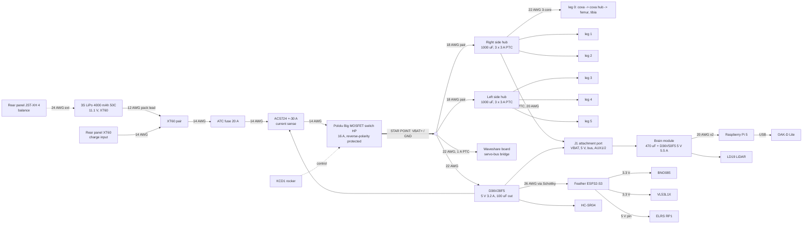

# Hexapod Mk1 (rev B2): wiring and harness

**Every wire is in the CAD.**
- Each cable is a routed **`Harness …`** component at its real diameter.
- Every connector is a **`Plug …`** or board component.
- Leg cables are split where they cross a joint, at a point on that joint's axis, so they don't stretch as the joint turns. Each one also gets a service loop there.

**Checked.** The collision sweep (`cad/interference_report.json`) checks the parts *and* the harness at 49 poses: 46 are clean, and the other 3 are the femur-10°-down + tibia-folded corner that the coupled joint limit rules out.

**Generated.** The cut list below comes from the CAD route lengths (`cad/cut_list.py`).

## 1. Power tree

## 2. Wire sizing

**Copper resistance** at 20 °C: 12 AWG 5.2, 14 AWG 8.3, 18 AWG 20.9, 20 AWG 33.3, 22 AWG 53, 26 AWG 134, 28 AWG 213 mΩ/m.

**Chassis ampacity** (single wire in free air): 14 AWG ≈ 32 A, 18 AWG ≈ 16 A, 20 AWG ≈ 11 A, 22 AWG ≈ 7 A. Sources: the [Cicoil current rating guide](https://cicoil.com/images/pdf/technical-support/Current_Rating_Guide_for_Wire_v11.pdf) and [Engineering ToolBox, AWG current ratings](https://www.engineeringtoolbox.com/wire-gauges-d_419.html). Silicone insulation (200 °C) is rated higher than PVC.

**Every wire that flexes is silicone-insulated, fine-stranded wire.**

| Run | Current (continuous / peak) | Wire | Route (mm) | Round-trip resistance | Drop at peak | Notes |
| --- | --- | --- | --- | --- | --- | --- |
| Battery → switch (main path) | 6 A / 25 A (stall 50 A) | 14 AWG | 77 + pack lead 100 | 1.3 mΩ wire + ≈ 9 mΩ (2 XT60, fuse, ACS724, MOSFET) | **0.26 V (2.3 %)** | 20 A fuse protects 14 AWG (32 A) |
| Switch → each side hub | 3 A / 12.5 A | 2 × 18 AWG | 87 | 3.6 mΩ | 45 mV | |
| Side hub → coxa servo (3 servos) | 1 A / 4 A | 22 AWG 3-core | 52–157 | 17 mΩ (157 mm) | 67 mV | 5264 contacts are rated 3 A: peaks are brief, and a 3 A-hold PTC per leg trips on a sustained stall |
| Coxa servo → coxa hub (2 servos) | 0.8 / 3 A | 22 AWG | 105 | 11 mΩ | 33 mV | Crosses the coxa axis with a 30 mm loop |
| Coxa hub → femur / tibia servo | 0.5 / 2 A | 22 AWG | 128 / 200 | 14 / 21 mΩ | 28 / 32 mV | The tibia lead crosses the femur axis on the axis |
| **Worst servo (tibia), total** | | | | | **≈ 0.13 V + 0.26 V = 0.4 V (3.5 %)** | Servos are rated 6–12.6 V |
| J1 (attachment / brain) | 1.6 A / 5 A | 2 × 20 AWG (VBAT on 2 + GND on 2 XH pins) | 209 | 14 mΩ | 70 mV | 5 A-hold PTC. JST-XH is 3 A per contact |
| Brain buck → Pi 5 V | 2.3 / 3.5 A | 2 pairs × 20 AWG | 29 | 1 mΩ | 4 mV | Both GPIO 5 V and both GND pins |
| 5 V logic buck → Feather | 0.3 A | 26 AWG | 62 | 17 mΩ | 5 mV | Through a Schottky (SS14), so USB from a PC can't back-feed the buck |
| Signals (UART, I²C, foot switches, sense) | mA | 26–28 AWG | | | | Twisted with their ground; I²C under 300 mm |

## 3. Connectors and their ratings

| Connector | Where | Rating | Source |
| --- | --- | --- | --- |
| **XT60** (genuine Amass) | Battery, charge port | 30 A continuous, 60 A burst | [Amass XT60 product sheet](https://www.amasshobby.com/) (AMASS XT60H data) |
| ATC blade fuse 20 A + inline holder (14 AWG) | After the battery XT60 | 20 A | Littelfuse ATO/ATC 257 series data |
| **Molex 5264** (2.50 mm, Feetech bus leads) | Every servo, side hubs, coxa hubs | 3 A per contact, 22–28 AWG crimps | Molex 50-37-5033 / 5263 terminal data (molex.com) |
| **JST-XH** 2.5 mm | J1 (8-pin), balance (4-pin) | 3 A per contact, 22–30 AWG | [JST XH data sheet](https://www.jst-mfg.com/product/pdf/eng/eXH.pdf) |
| **JST-SH** 1.0 mm (STEMMA QT / Qwiic) | BNO085, VL53L1X, Feather I²C; Waveshare header | 1 A | [JST SH data sheet](https://www.jst-mfg.com/product/pdf/eng/eSH.pdf) |
| JST-ZH 1.5 mm | LD19 | 1 A | LD19 data sheet ([Waveshare wiki](https://waveshare.com/wiki/DTOF_LIDAR_LD19)) |
| 5.5 × 2.1 mm barrel | Waveshare bridge power | 3–5 A | |
| USB-C | Feather (host), OAK-D Lite | 3 A (cable) | |
| PTC resettable fuse **Littelfuse RXEF300** (×6) | One per leg branch on the side hubs | 3.0 A hold / 5.1 A trip | Littelfuse RXEF data sheet |
| PTC **RXEF500** | J1 VBAT | 5.0 A hold / 8.5 A trip | Littelfuse RXEF data sheet |
| PTC **RXEF110** | Bridge DC feed | 1.1 A hold | Littelfuse RXEF data sheet |

**Fusing summary.**
- Main 20 A blade fuse.
- One 3 A PTC per leg, so a stalled or shorted leg can't take the others down.
- 5 A PTC on J1 and 1.1 A on the bridge.
- The 5 V bucks are current-limited internally.

## 4. Grounding, noise and capacitors

- **Star ground.** The switch output's GND terminal is the only point where the servo returns (the side-hub 18 AWG grounds), the logic ground (the 5 V buck's GND) and J1 meet. Servo current never flows through a logic or signal ground wire.
- **Signal grounds.** Each signal lead carries its own ground conductor as a reference: bridge UART, I²C, foot leads, J1 AUX. These carry only mA. The Feather has a single power-ground path, from the 5 V buck lead.
- **Noisy and quiet rails kept apart.**
  - VBAT servo power runs in the side hubs and leg branches only.
  - The logic 5 V comes from its own buck.
  - The Feather, receiver, IMU and ToF sit in the control pod on top, away from the battery current path.
  - The IMU lead runs on the left corridor, away from the bus trunks.
- **Bulk capacitors.**
  - 1000 µF / 25 V low-ESR electrolytic on each side hub, across VBAT–GND. It absorbs servo current steps and regenerative spikes.
  - 470 µF / 25 V at the brain buck's input.
  - 100 µF / 10 V on the 5 V logic rail.
  - The ESP32 boards already carry their own 10–22 µF ceramics.
- **Twisting.** Twist VBAT/GND pairs (2 turns per 100 mm) and each foot-switch pair.

## 5. Pin maps

**Feather ESP32-S3** (main controller): see [CONTROL.md §2](CONTROL.md).

**Waveshare Servo Driver with ESP32** (bus bridge, `firmware/bus_bridge`):

| Pin | Use |
| --- | --- |
| GPIO18 / 19 | Servo bus (on-board half-duplex circuit) |
| GPIO21 (SDA) / 22 (SCL) on the OLED header | UART to the Feather (RX / TX) + GND |
| GPIO34 | VBAT through 100k/22k (11.0 V → 1.98 V) |
| GPIO35 | ACS724 VOUT through 10k/20k |
| DC jack | VBAT through a 1.1 A PTC |

**J1 attachment port** (JST-XH 8, on the QR receiver):

| Pin | 1 | 2 | 3 | 4 | 5 | 6 | 7 | 8 |
| --- | --- | --- | --- | --- | --- | --- | --- | --- |
| Signal | GND | GND | VBAT (5 A PTC) | VBAT | +5 V (logic buck) | Servo bus DATA | AUX1 (Feather A2) | AUX2 (Feather A3) |

- **Weapon modules** use AUX1 as the fire line and tie AUX2 to GND through 10 kΩ.
- **The brain module** uses AUX1/AUX2 as a UART (Pi TX → AUX2, AUX1 → Pi RX).
- The Feather tells them apart at boot from AUX2's idle level.

**Raspberry Pi 5** (brain):

| Pin | Use |
| --- | --- |
| 2, 4 (5 V), 6, 9 (GND) | Power from the D36V50F5 |
| 8 (GPIO14 TXD) | → J1 AUX2 |
| 10 (GPIO15 RXD) | ← J1 AUX1 |
| GPIO5 (UART2 RXD, `dtoverlay=uart2-pi5`) | ← LD19 TX |
| 5 V / GND | → LD19 |
| USB 3 | → OAK-D Lite |

**Side hub** (perfboard, 18 × 18 mm):
- Two copper bus bars (VBAT, GND) with the 18 AWG trunk soldered on, plus a 1000 µF capacitor.
- Three PTC-fused 5264 outputs (front, middle and rear leg) and one data input from the bridge.
- The right hub also has the J1 output (5 A PTC).

**Coxa hub** (14 × 14 mm, on the coxa bracket): three 5264 headers (input, femur, tibia), all pin-1s together, all pin-2s together, all pin-3s together.

**Foot switch** (Omron D2F-01): COM → black, NO → white. White goes to the Feather foot pin (INPUT_PULLUP) and black to Feather GND. A pressed boot reads LOW.

## 6. Routing features in the printed parts

| Feature | Part | Purpose |
| --- | --- | --- |
| Zip-tie slot pairs beside each coxa servo | Plate_Bottom_Front/Rear | Strain relief where the leg branches leave the body |
| Zip-tie slot pairs along each foot lead (6 pairs) | Plate_Top_Front/Rear | Hold the foot leads flat on the top plate |
| Foot-lead fins with a snap notch (both arms) | Femur | Keep the lead on the femur axis line, close to the femur pivot, clear of the tibia's fold |
| 2.6 × 1.3 mm foot-lead groove on both outer faces, plus a cross slot and internal channel | Tibia | Lead protected in the groove, then inside the tip to the switch |
| Sealed switch pocket + sliding boot with lips and a plunger nub | Tibia + FootBoot_TPU | Foot sensor protected from dirt and impact |
| Cable entries: 3 floor holes, 4 side-wall holes per side (one spare each side), front-wall ToF entry, USB-C cut-out | ControlPod | Every lead enters through its own hole, so nothing is pinched by the lid |
| Antenna post | ControlPodLid | Holds the receiver antenna vertically |
| Lead hole and channel | ImuPod, bottom plate | IMU lead from under the belly into the body |
| Pass-through 30 × 14 mm (J1, charge, balance, rocker leads) and panel slot | Top plate, PowerPanel | As rev B |
| J1 plug opening, camera-cable holes, lid access hole | BrainBase / BrainCamMount / BrainLid | Brain cables |
| **Spare** | One spare entry per pod side wall, two spare 5264 positions on each side hub, A5 + BOOT pins, I²C 0x40 free | Future sensors and attachments |

All edges where a cable passes are rounded or chamfered by the generator's edge-break pass, at 0.8 mm minimum.

**Service loops at the joints.**
- **Coxa.** Bus and foot leads cross the coxa axis vertically above the bracket. That allows ±45° of twist over a 30 mm free length.
- **Femur and knee.** Leads cross exactly on the axis, beside the arms.
- **Bend radius.** At least 5× the cable diameter everywhere in the joint range.
- **Checked at:** coxa ±45°, femur −70…+10° and tibia −120…+45° (Fusion signs).

## 7. Cut list (generated from the CAD routes)

| Cable | Qty | From → to | Wire | Colours | End A | End B | A (cont / peak) | Routed (mm) | **Cut (mm)** |
| --- | --- | --- | --- | --- | --- | --- | --- | --- | --- |
| Bus trunk R | 1 | switch output / bridge bus port → side hub | 2 x 18 AWG + 1 x 26 AWG | red / black / yellow | solder (switch) + 5264 (data) | solder (hub bus bars) + 5264 | 3 / 12.5 | 87.0 | **130** |
| Bus trunk L | 1 | switch output / bridge bus port → side hub | 2 x 18 AWG + 1 x 26 AWG | red / black / yellow | solder (switch) + 5264 (data) | solder (hub bus bars) + 5264 | 3 / 12.5 | 87.0 | **130** |
| Bus coxa0 | 1 | side hub (3 A PTC) → coxa servo | 3 x 22 AWG | red / black / yellow | Molex 5264-3 | Molex 5264-3 | 1 / 4 | 157.0 | **210** |
| Bus coxa1 | 1 | side hub (3 A PTC) → coxa servo | 3 x 22 AWG | red / black / yellow | Molex 5264-3 | Molex 5264-3 | 1 / 4 | 52.0 | **80** |
| Bus coxa2 | 1 | side hub (3 A PTC) → coxa servo | 3 x 22 AWG | red / black / yellow | Molex 5264-3 | Molex 5264-3 | 1 / 4 | 80.0 | **120** |
| Bus coxa3 | 1 | side hub (3 A PTC) → coxa servo | 3 x 22 AWG | red / black / yellow | Molex 5264-3 | Molex 5264-3 | 1 / 4 | 114.0 | **160** |
| Bus coxa4 | 1 | side hub (3 A PTC) → coxa servo | 3 x 22 AWG | red / black / yellow | Molex 5264-3 | Molex 5264-3 | 1 / 4 | 52.0 | **80** |
| Bus coxa5 | 1 | side hub (3 A PTC) → coxa servo | 3 x 22 AWG | red / black / yellow | Molex 5264-3 | Molex 5264-3 | 1 / 4 | 80.0 | **120** |
| J1 bus+power | 1 | right hub + 5 V buck → J1 (receiver) | 2 x 20 AWG + 4 x 26 AWG | red / black / orange / yellow | solder / 5264 | JST-XH 8 female | 1.5 / 5 | 209.0 | **270** |
| Battery lead | 1 | battery → XT60 pair | 2 x 12 AWG (pack lead) | red / black | XT60 (pack) | XT60 male | 6 / 25 | 49.0 | **80** |
| XT60 to fuse | 1 | XT60 pair → fuse holder | 14 AWG silicone | red | XT60 female | ATC holder | 6 / 25 | 5.0 | **30** |
| Fuse to ACS724 | 1 | fuse holder → ACS724 IP+ | 14 AWG silicone | red | ATC holder | screw terminal | 6 / 25 | 12.0 | **40** |
| ACS724 to switch | 1 | ACS724 IP- → MOSFET switch VIN | 14 AWG silicone | red | screw terminal | solder | 6 / 25 | 11.0 | **40** |
| VBAT to driver | 1 | switch output → bridge DC jack | 2 x 22 AWG | red / black | solder | 5.5 x 2.1 plug | 0.2 | 9.0 | **40** |
| VBAT to buck | 1 | switch output → D36V28F5 VIN | 2 x 22 AWG | red / black | solder | solder | 0.3 / 1 | 44.0 | **80** |
| VBAT sense | 1 | switch output → bridge GPIO34 (100k/22k) | 26 AWG | red/white | solder | solder + heat-shrink | < 0.001 | 17.0 | **40** |
| Charge lead 0 | 1 | rear panel XT60 → battery node | 14 AWG silicone pair | red / black | XT60 female (panel) | solder at XT60 pair | 2 (charging) | 223.0 | **280** |
| Charge lead 1 | 1 | rear panel XT60 → battery node | 14 AWG silicone pair | red / black | XT60 female (panel) | solder at XT60 pair | 2 (charging) | 220.0 | **280** |
| Balance extension | 1 | pack balance lead → rear panel | 4 x 24 AWG | pack colours | JST-XH 4 female | JST-XH 4 panel | < 0.5 | 169.0 | **220** |
| Switch control | 1 | rocker → MOSFET switch CTRL | 2 x 26 AWG | grey | solder (rocker) | solder | < 0.01 | 195.0 | **250** |
| ACS724 signal | 1 | ACS724 VOUT → bridge GPIO35 (10k/20k) | 26 AWG | blue | solder | solder | < 0.001 | 1.0 | **30** |
| Sonar | 1 | HC-SR04 → Feather A0/A1 + 5 V | 4 x 26 AWG | orange / black / white / green | Dupont 4 | solder | 0.02 | 58.0 | **90** |
| ToF sensor | 1 | VL53L1X → Feather I2C (daisy) | 4 x 28 AWG | red / black / blue / yellow | solder | JST-SH 4 | 0.02 | 42.0 | **70** |
| IMU lead | 1 | BNO085 STEMMA QT → Feather STEMMA QT | 4 x 28 AWG (STEMMA QT cable, 200 mm) | red / black / blue / yellow | JST-SH 4 | JST-SH 4 | 0.02 | 154.0 | **200** |
| Feather 5V | 1 | D36V28F5 VOUT → Feather USB pin (via Schottky) | 2 x 26 AWG | orange / black | solder | solder | 0.3 | 62.0 | **100** |
| Bridge UART | 1 | bridge GPIO21/22 + GND → Feather RX/TX + GND | 3 x 28 AWG | white / green / black | JST-SH 4 (header) | solder | < 0.01 | 65.0 | **100** |
| J1 aux | 1 | Feather A2/A3 → J1 AUX1/AUX2 | 2 x 28 AWG | white / green | solder | JST-XH crimp (J1) | < 0.01 | 129.0 | **170** |
| Foot lead plate 0 | 1 | pod side wall → Feather foot pin + GND | 2 x 28 AWG twisted | white / black | solder | (continues as Foot lead A) | < 0.001 | 49.0 | **80** |
| Foot lead plate 1 | 1 | pod side wall → Feather foot pin + GND | 2 x 28 AWG twisted | white / black | solder | (continues as Foot lead A) | < 0.001 | 92.0 | **130** |
| Foot lead plate 2 | 1 | pod side wall → Feather foot pin + GND | 2 x 28 AWG twisted | white / black | solder | (continues as Foot lead A) | < 0.001 | 170.0 | **220** |
| Foot lead plate 3 | 1 | pod side wall → Feather foot pin + GND | 2 x 28 AWG twisted | white / black | solder | (continues as Foot lead A) | < 0.001 | 49.0 | **80** |
| Foot lead plate 4 | 1 | pod side wall → Feather foot pin + GND | 2 x 28 AWG twisted | white / black | solder | (continues as Foot lead A) | < 0.001 | 92.0 | **130** |
| Foot lead plate 5 | 1 | pod side wall → Feather foot pin + GND | 2 x 28 AWG twisted | white / black | solder | (continues as Foot lead A) | < 0.001 | 171.0 | **220** |
| Receiver CRSF | 1 | RP1 V2 → Feather D11/D12 + 5 V | 4 x 28 AWG (RP1 lead) | red / black / white / green | RP1 pads | solder | 0.06 | 4.0 | **30** |
| Receiver antenna | 1 | RP1 UFL → lid post | UFL T-antenna coax | stock | UFL | - | - | 39.0 | **70** |
| Brain power | 1 | J1 plug VBAT/GND → D36V50F5 VIN (470 uF) | 2 x 20 AWG | red / black | JST-XH 8 male | solder | 1.6 | 64.0 | **100** |
| Brain UART | 1 | J1 plug AUX1/AUX2 → Pi GPIO14/15 (pins 8/10) | 2 x 28 AWG | white / green | JST-XH 8 male | Dupont 2 | < 0.01 | 102.0 | **140** |
| Brain 5V Pi | 1 | D36V50F5 VOUT → Pi GPIO 5 V (pins 2, 4) / GND (6, 9) | 2 + 2 x 20 AWG | red / black | solder | Dupont 2 + 2 | 2.3 / 3.5 | 29.0 | **60** |
| OAK USB | 1 | Pi USB 3 → OAK-D Lite USB-C | USB-C cable, right-angle, 150 mm | - | USB-A right-angle | USB-C | 0.9 | 120.0 | **160** |
| LD19 lead | 1 | LD19 ZH1.5-4 → Pi GPIO5 (UART2 RX) + 5 V | 4 x 28 AWG (stock lead) | stock | ZH 1.5-4 | Dupont | 0.18 | 50.0 | **80** |
| Bus coxa servo-hub A | 6 | side hub (3 A PTC) → coxa servo | 3 x 22 AWG | red / black / yellow | Molex 5264-3 | Molex 5264-3 | 1 / 4 | 75.0 | **110** |
| Foot lead A | 6 | D2F switch (NO, COM) → over the plate to the pod | 2 x 28 AWG twisted silicone | white / black | solder + heat-shrink | one piece with "plate" | < 0.001 | 48.0 | **80** |
| Bus coxa servo-hub B | 6 | side hub (3 A PTC) → coxa servo | 3 x 22 AWG | red / black / yellow | Molex 5264-3 | Molex 5264-3 | 1 / 4 | 30.0 | **60** |
| Bus hub-femur | 6 | coxa hub → femur servo | 3 x 22 AWG | red / black / yellow | Molex 5264-3 | Molex 5264-3 | 0.5 / 2 | 128.0 | **170** |
| Bus hub-tibia A | 6 | coxa hub → tibia servo | 3 x 22 AWG | red / black / yellow | Molex 5264-3 | Molex 5264-3 | 0.3 / 1.5 | 100.0 | **140** |
| Foot lead B | 6 | D2F switch (NO, COM) → over the plate to the pod | 2 x 28 AWG twisted silicone | white / black | solder + heat-shrink | one piece with "plate" | < 0.001 | 100.0 | **140** |
| Bus hub-tibia B | 6 | coxa hub → tibia servo | 3 x 22 AWG | red / black / yellow | Molex 5264-3 | Molex 5264-3 | 0.3 / 1.5 | 100.0 | **140** |
| Foot lead C | 6 | D2F switch (NO, COM) → over the plate to the pod | 2 x 28 AWG twisted silicone | white / black | solder + heat-shrink | one piece with "plate" | < 0.001 | 75.0 | **110** |
| Foot lead D | 6 | D2F switch (NO, COM) → over the plate to the pod | 2 x 28 AWG twisted silicone | white / black | solder + heat-shrink | one piece with "plate" | < 0.001 | 123.0 | **170** |

Wire to buy (sum of cut lengths, before 20 % spare): 14 AWG silicone: 0.11 m; 14 AWG silicone pair: 0.56 m; 2 + 2 x 20 AWG: 0.06 m; 2 x 12 AWG (pack lead): 0.08 m; 2 x 18 AWG + 1 x 26 AWG: 0.26 m; 2 x 20 AWG: 0.10 m; 2 x 20 AWG + 4 x 26 AWG: 0.27 m; 2 x 22 AWG: 0.12 m; 2 x 26 AWG: 0.35 m; 2 x 28 AWG: 0.31 m; 2 x 28 AWG twisted: 0.86 m; 2 x 28 AWG twisted silicone: 3.00 m; 26 AWG: 0.07 m; 3 x 22 AWG: 4.49 m; 3 x 28 AWG: 0.10 m; 4 x 24 AWG: 0.22 m; 4 x 26 AWG: 0.09 m; 4 x 28 AWG: 0.07 m; 4 x 28 AWG (RP1 lead): 0.03 m; 4 x 28 AWG (STEMMA QT cable, 200 mm): 0.20 m; 4 x 28 AWG (stock lead): 0.08 m; UFL T-antenna coax: 0.07 m; USB-C cable, right-angle, 150 mm: 0.16 m

## 8. Assembly: when each cable goes in

1. **Bottom plate.**
   1. Fit the side hubs and solder their 18 AWG trunks before mounting.
   2. Mount the XT60 pair and fuse holder.
   3. Fit the ACS724 and the bridge board, then the VBAT-sense and ACS-signal leads.
2. **Coxa servos.** Plug each `Bus coxaN` into its servo, route it past the zip-tie slots, and tie it at the hub side.
3. **Underside.** Fit the ImuPod and BNO085, threading the IMU lead up through the bottom-plate hole.
4. **Top plate and carrier.**
   1. Fit the MOSFET switch and the 5 V buck, and solder the main 14 AWG path.
   2. Run the bridge UART, Feather 5 V and IMU leads up through the floor holes **before** the plate goes on.
5. **Top side.**
   1. Fit the rear panel (charge XT60, balance, rocker).
   2. Fit the QR receiver with J1, the J1 lead and the J1 aux lead.
   3. Fit the front bracket with the sonar and VL53L1X. The ToF lead goes into the pod's front wall.
6. **Control pod.**
   1. Fit the Feather and receiver, then solder all leads to the Feather pads.
   2. Fit the antenna in the lid post and close the lid.
7. **Legs, each leg.**
   1. Plug the coxa servo's second socket to the coxa hub, then the hub-femur and hub-tibia leads.
   2. Fit the foot switch with its lead in the tibia, lay the lead in the tibia groove, snap it into the femur fin, and cross the coxa axis above the hub.
   3. Lay it along the top plate, tie it in the plate slots, and pass it into the pod's side wall.
8. **Check every rail before fitting the battery.** Use a bench supply at 12 V with a 3 A limit:
   - 5 V on J1 pin 5;
   - VBAT on J1 pins 3/4;
   - no short across either hub;
   - foot bits toggling in the `T,` lines.
9. **Battery.** Slide it in from the rear and connect the XT60 and balance extension. It **swaps and charges without unplugging anything else** (rear panel).
10. **Brain module.** Slide it onto the dovetail, plug its lead into J1, and fit the lock screw through the lid hole.

**Removing boards.** Every board is screwed down with its leads soldered at one end and plugged at the other, so each one can be unplugged and removed on its own.
