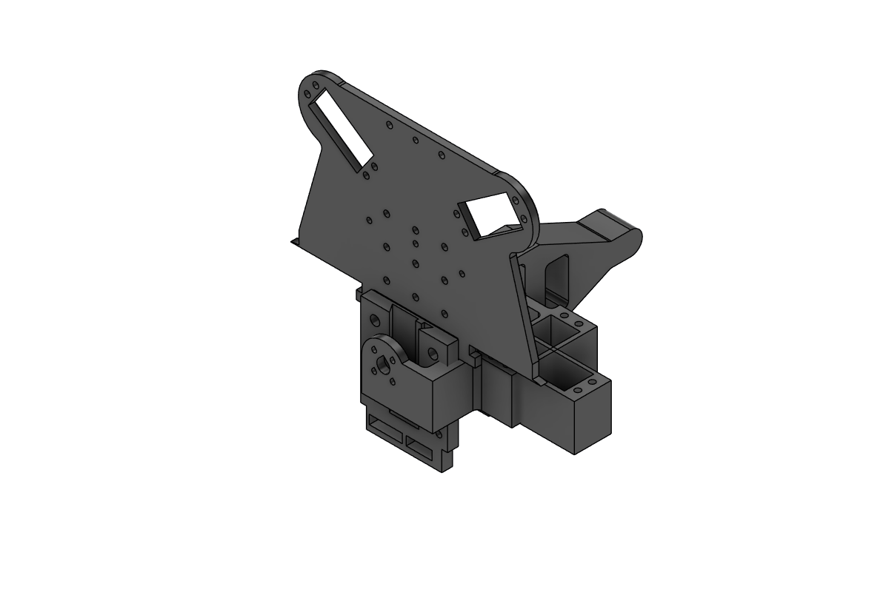
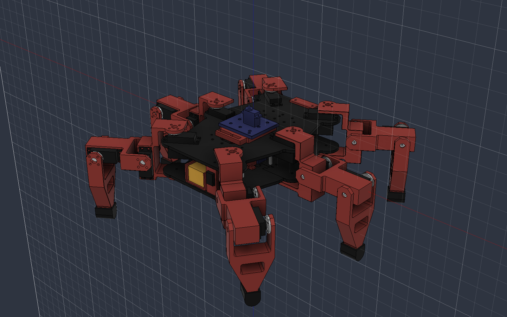

# 02 · Concept: Mk1 rev A (MG996R + PCA9685)
*2026-11-25*

**Architecture.**
- 18 × MG996R PWM servos on two PCA9685 boards, with an ESP32 bridging USB from the sim.
- 2S LiPo through a UBEC.
- Two 5 mm body plates 45 mm apart.
- **Coxa:** a printed U-clevis around the coxa servo, plus a cradle for the femur servo.
- **Femur:** a clevis plus a cradle for the tibia servo.
- **Tibia:** a clevis and a tapered shank.
- Every joint had a 623ZZ bearing on an M3 bolt opposite the servo horn.

**Key decisions.**
- Plates grew 21 mm lobes round each coxa axis so the servo tab screws had material under them. The body became 262 × 202 mm.
- The plates were split in two with T-shaped jigsaw keys, and the top and bottom seams were offset, so they fit a 220 mm bed.
- The left legs reuse the right-leg parts, rotated (not mirrored).
- The generator builds every part from primitives and adds fillets automatically: it detects concave edges with a two-point containment test.

