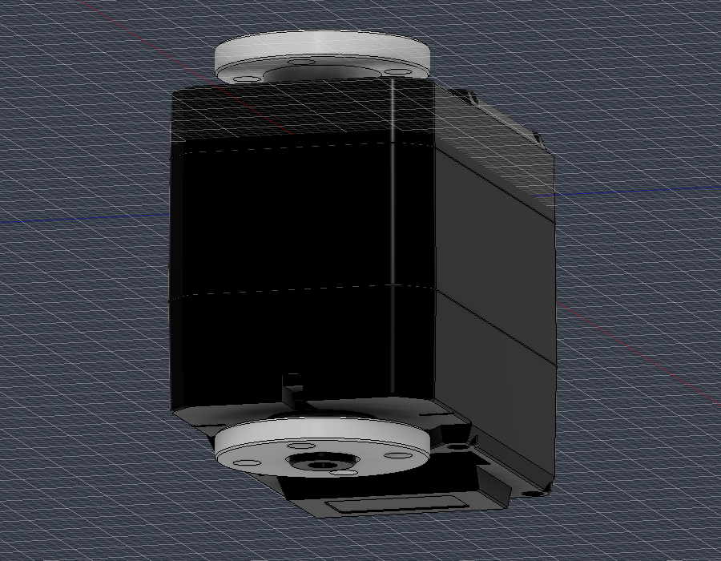

# 05 · Rev B brief
*2026-11-25*

1. **Actuators.** Easy to buy, with official CAD, and at least **2× rated (continuous) torque** in the worst case: tripod stance with the full robot plus a 0.4 kg attachment, at the widest stance the gait uses. Bus servos with feedback are a plus for the twin. Keep the USB protocol.
2. **Power.** One rechargeable pack powers everything.
   - Sized for ≥ 30 min walking, with an idle / walking / peak current budget.
   - Charge port in the robot, and a battery you can still swap.
   - Main switch, fuse, XT60, logic buck, current and voltage sensing, firmware low-voltage cutoff.
   - Attachment port with switched rails and stated limits.
   - Student-safe: no bare cells, fusing, strain relief.
3. **Real CAD.** Manufacturer STEP models for the servos, boards and standard parts. Downloaded only from official sources, with licences respected.
4. **Redesign and re-check.** Collision sweep, re-export everything, update the config, firmware and docs, save a new version to the cloud.

Later in the same session the user added:
- fillets and chamfers on every stress corner, with no interference;
- every wire, cable and connection modelled;
- this design notebook.

