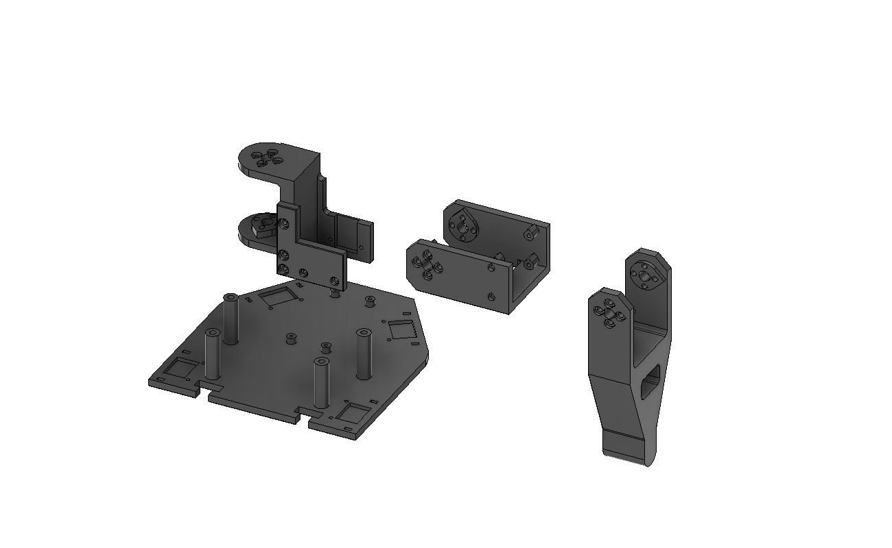

# 06 · Actuator selection and load analysis
*2026-11-25*

**Candidates** (checked on the web on 2026-11-25):

| Servo | 12 V stall / rated | Price | Official CAD | Verdict |
| --- | --- | --- | --- | --- |
| Feetech STS3215 / Waveshare ST3215 | 30 / 10 kg·cm | about $20–22 | Waveshare STEP | **Chosen** for the coxa and tibia |
| Feetech STS3250 | 50 / 16 kg·cm | about $97–99 | Same housing as the ST3215 | **Chosen** for the femur |
| Hiwonder HTS-35H | 35 kg·cm at 11.1 V, rated not published | about $30 | None found | Rejected: no rated torque, no CAD |
| DS3218MG (PWM) | 20 kg·cm stall | about $15–19 | None official | Rejected: PWM, no feedback |

**Load model** (`cad/load_calc.py`).
- **Femur:** F × the horizontal distance from the femur axis to the foot.
- **Tibia:** the worst F × knee-to-foot offset over the stance ring.
- **Coxa:** a sideways push of 0.3 F.
- Here F = (m_robot + 0.4 kg) · g / 3.

The gait-reach study showed that the uncapped sim gait can ask for 194 mm from the coxa axis. That needs 16 kg·cm at the femur, and nothing affordable carries that at a 2× margin. **Decision: keep every stance foot 80–115 mm from its coxa axis** (`footReachMin/Max`, nominal 100 mm).

{{loads}}

