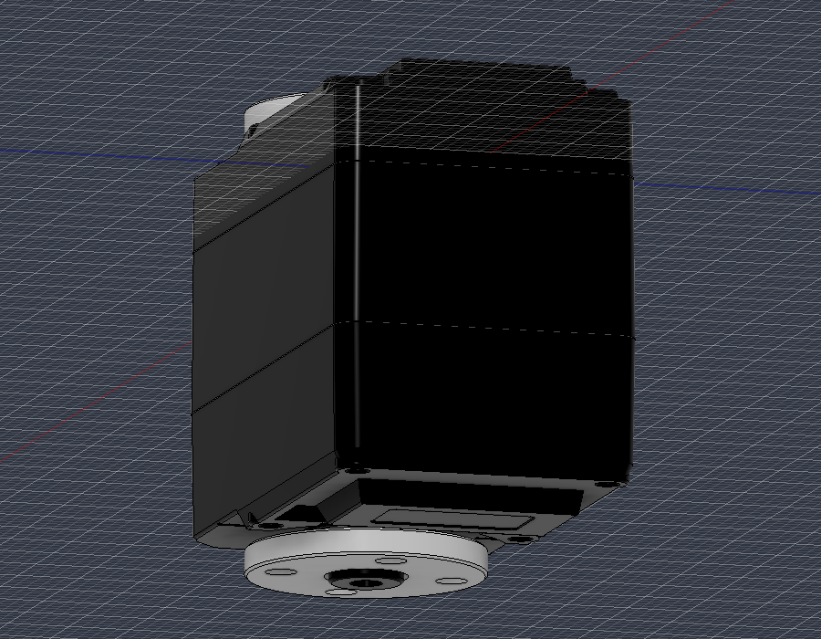

# 08 · Manufacturer CAD and licensing
*2026-11-25*

**Downloaded** from official servers, with no login and no executables (`cad/vendor/fetch_vendor_cad.py`):
- Waveshare ST3215 STEP and 2D drawing.
- Waveshare Servo Driver with ESP32 STEP.
- Pololu D36V28Fx, Big MOSFET switch and ACS724 STEPs.

**Licences.** None of these files states a redistribution licence, so the repo links to them and fetches them instead of committing copies. The generator copies them to a short temp path, because the repo path exceeds Windows' 260-character limit. It falls back to datasheet envelopes if they're missing. The repo `.f3d`, STLs and sim meshes come from the envelope build. The cloud design uses the real models.

**Manual-download list** (login-gated or no official model): STS3250 (same housing as the ST3215), STS3032, the LiPo, HC-SR04, XT60, switch, fuse holder, Molex/JST plugs, screws and inserts (McMaster STEP in the browser). See `cad/vendor/SOURCES.md`.

**Measured from the ST3215 STEP** (servo frame L):

| Feature | Value |
| --- | --- |
| Horn faces | ±18.625 |
| Seating faces | +13.825 (with label boss) / −16.575 (with pad) |
| Case | x −10.11 … 35.11, y ±12.36 |
| Horn holes | 4 × M3 on a 14 mm circle |
| M2 case holes | top x 29.0, bottom x 32.75, y ±10.25 |
| Bus sockets | side entry at x 13.9, z −8.5, on both long faces (found from the socket block in the STEP; plain-face searches showed nothing) |

