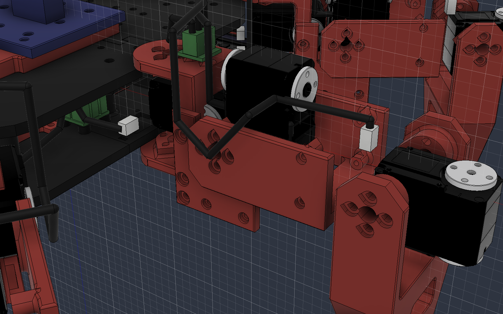

# 11 · Wiring harness, modelled
*2026-11-25*

Every cable is a routed pipe of real diameter, and every connector a body, each in the rigid group it moves with.

**Iteration history.**
1. **First routing.** Many crossings in the cramped front bay. The power chain was simplified: the ACS724 moved directly under the MOSFET switch, and the attachment port lost its 5 V line (attachments make their own).
2. **Joint sweeps with the cables.** Leg cables drawn rigid in one link were hit by the moving parts. Leads were split where they cross a joint, at a point **on the joint axis**, so neither segment moves as the joint turns.
3. **Still hit at tibia fold and femur-down.** Leads running under the femur were in the way. A 3-socket **bus hub on top of each coxa** fixed it: one lead to the femur servo, and one over the femur arms to the tibia servo's top socket.
4. **Final sweep.** Clean at every pose inside the limits. The femur-down limit was tightened to 10° (the gait needs 4°), and the tibia fold is coupled with the femur angle (−135° when the femur is level or up, −132° when it is up to 10° down).

{{harness}}

{{interference}}

