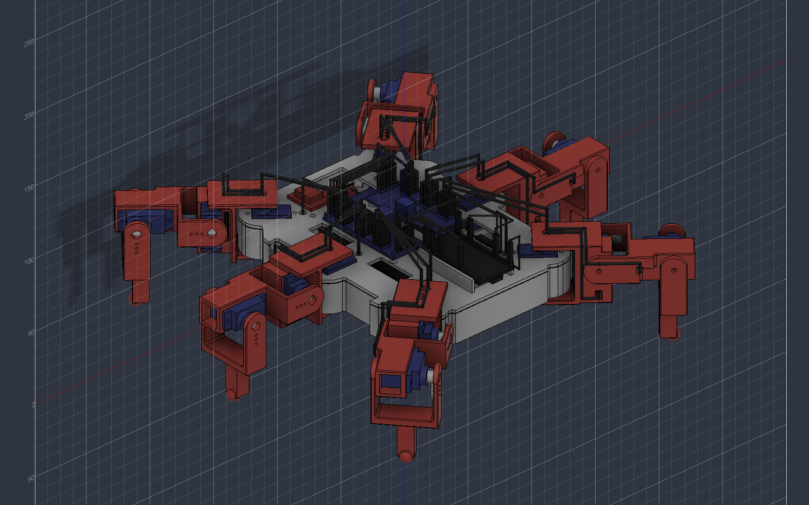

# 19 · Hexapod Mini: a remote-control hexapod for under $200
*2026-11-26*

**Brief.** Mk1 costs $900–1,900. Oli also wants a small robot that:

- walks, turns and strafes from a hand-held remote;
- runs on a rechargeable battery;
- is safe to build;
- costs **under US$200 for everything**: filament, battery, charger and remote included.

It is remote-control only, with no autonomy. Everything is in [`robot-sim/mini/`](../../../mini/); the Mk1 files are unchanged.

## Decisions

| Question | Options looked at | Chosen | Why |
| --- | --- | --- | --- |
| Actuators | MG90S, SG90, Feetech SCS0009 bus servos | **18 × MG90S** ($43) | The bus servos alone would cost $110–160. SG90 plastic gears strip |
| Remote | ExpressLRS radio + receiver ($70–100), Bluetooth gamepad | **Bluepad32 gamepad** ($21, 8BitDo Lite 2) | A fifth of the price, and it uses the ESP32's radio. A classic ESP32 is needed for Bluetooth Classic pads |
| Battery | 2S LiPo, 2S 18650 | **2 × 18650 (Molicel P28A)** + 2S BMS + 10 A fuse | Steel cans, charged outside the robot in a $7 charger, cell by cell |
| Servo power | one big buck, two small | **2 × Mini560 5 V 5 A** | Fits under the deck, one per side |

**Total: about $196** with shipping. See [BOM.md](../../../mini/docs/BOM.md) for the links, and for which prices were checked and which are approx.

## Engineering

**Conventions.** The design follows Mk1's:

- a parametric Fusion generator made from TemporaryBRep primitives;
- inside-corner fillets, bed chamfers and edge breaks;
- teardrop holes;
- joints and rigid groups;
- every wire modelled.

**Leg.** Coxa 30, femur 44, tibia 60 mm. Each joint has a horn arm, plus an idler arm on an M3 pin on the far side of the servo, so no joint hangs on a micro servo's shaft alone.

**Parts.** The six legs use the same three printed parts, turned rather than mirrored.

**Load check.** The weight is shared over a real tripod, not m g / 3:

- the lone middle foot carries 44 % of the weight;
- with the stance-window rule (middle feet within 61 mm of the coxa axis), the femur has **2.0–2.1 ×** the MG90S datasheet torque at 5 V;
- the coxa and tibia have 3–5 ×.

The datasheet figure is a stall torque, which the design doc says plainly: the servos are worked hard, so the firmware sits the robot down whenever it is idle.

**Interference.** Fusion's interference analysis checks:

- the neutral pose;
- 20 poses per leg (coxa ±40°, femur and tibia past their limits);
- neighbouring legs swung towards each other to the 25° firmware coxa limit.

The sweep found five problems, all fixed:

- servo tabs in the tray wall;
- an over-reaching sweep cut-out;
- the tibia arm against the femur skin;
- neighbouring legs at 40°;
- fillets touching servos.

The final build is clean (see DESIGN.md §5).

**Firmware.** The ESP32 runs the IK and gait in the simulator's own conventions:

- IK and tripod gait, with the stance-window rule;
- Bluepad32 sticks;
- arm/sit with A/B;
- failsafes on pad loss and low battery, with the OE pin forcing the servos limp;
- the sim's USB `S,` protocol.

Host tests pass. They cover the IK round trip, the tibia limit, that both tripods are never up, the stance window, the coxa range, coming to rest, and the channel map.

## Not yet verified

- Nothing has been printed, built or flashed.
- The MG90S and board shapes are datasheet envelopes. Print the coxa fit test first.
- The mass is a CAD estimate.
- The servo directions are checked on the stand.
