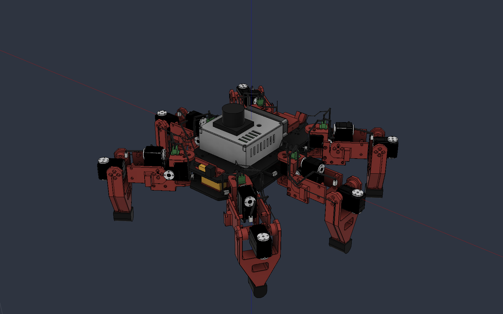

# 20 · Mk1 RC build: remote control first, autonomy later
*2026-11-26*

**Question.** Is the robot much cheaper if it is only driven by the radio and never runs on its own? Yes, so that's now the default build. The autonomous design stays in the repo as an upgrade.

## Cost options considered

| Build | What changes | All-in cost |
| --- | --- | --- |
| Full autonomy (rev B2 as designed) | STS3250 femurs + brain module + TX16S | ≈ US$1,920 |
| RC only | Drop the brain module | ≈ US$1,560 |
| **RC only + budget femurs (chosen)** | Also STS3215 femurs instead of STS3250 | **≈ US$1,110** |
| … with a RadioMaster Pocket | Also the cheaper radio | ≈ US$950 |

Dropping the brain saves about $350. Dropping the six STS3250s saves about $460, the biggest single item.

## What the budget femurs cost in margin

`cad/load_calc.py`: tripod stance, feet 80–115 mm from the coxa axis, 2.93 kg robot.

| Top attachment | Femur required | Margin vs rated (10 kg·cm) | Margin vs stall (30 kg·cm) |
| --- | --- | --- | --- |
| 0.4 kg (the autonomy allowance) | 7.77 kg·cm | 1.29× | 3.9× |
| **0.2 kg (RC cap)** | **7.22 kg·cm** | **1.39×** | **4.2×** |
| STS3250 femurs, 0.4 kg (autonomy build) | 7.84 kg·cm | 2.04× | 6.4× |

**Decision.**
- The 2× target can't be met with STS3215 femurs at any useful payload. Instead, the RC build:
  - caps top attachments at **0.2 kg**;
  - keeps the 80–115 mm stance window;
  - watches servo temperature in the `B,` telemetry and rests the robot above 60 °C.
- 4.2× under stall means it stands and walks with room to spare. It will only run warm on long sessions.
- The STS3250 drops into the same pocket, so the upgrade needs no reprinting.

## What changed

- **Generator.** `cad/hexapod_mk1_fusion.py` gained a `BUILD = 'rc' | 'autonomy'` switch:
  - it sets the femur servo model and its mass;
  - it shows the turret example on the top mount (RC) or the brain module (autonomy).
- **Files.**
  - `cad/Hexapod_Mk1.f3d` and `cad/build_report.json` are now the RC build.
  - The autonomy build is kept as `cad/Hexapod_Mk1_autonomy.f3d` / `build_report_autonomy.json`.
  - The cloud document "Hexapod Mk1" (version 3) stays the autonomy build. The RC build is a new cloud document, "Hexapod Mk1 RC".
- **Docs.**
  - DESIGN.md and BUILD.md describe both builds, with an RC load table.
  - ELECTRONICS.md marks the *autonomy upgrade* rows and totals both builds.
  - The simulator config uses `build: 'rc'`, 2.93 kg.
  - MuJoCo now reads the autonomy report, since it exists for the brain's policy.
- **Versions.** Every version, its git tag and its cloud document are listed in [VERSIONS.md](../../VERSIONS.md). The new tag is `mk1-revB2-rc`.

## Verification

- **Cloud build.** The RC build was rebuilt in Fusion with the vendor models; the renders in `docs/img` come from it.
- **Load check.** Re-run for 2.93 kg + 0.2 kg (table above).
- **MuJoCo.** Regenerated from the autonomy report: still stands at 88 mm and walks 0.58 m in 4 s.
- **Not yet done.** Nothing has been built. The femur temperatures with STS3215s need measuring on the real robot.
