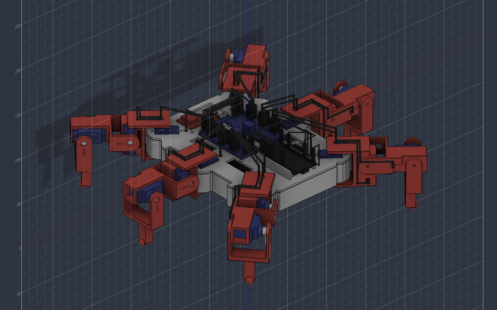

# Hexapod Mini

A remote-control mini hexapod that costs **under US$200 to build** (about $196, every part counted). It walks, turns and strafes from a Bluetooth gamepad and runs on two rechargeable 18650 cells. It was designed to be a safe first build for Oli.

| | |
| --- | --- |
| Servos | 18 × MG90S (metal gear), 3 per leg |
| Brain | ESP32-DevKitC + 2 × PCA9685 |
| Remote | 8BitDo Lite 2, or any Bluepad32 gamepad |
| Power | 2S 18650 Li-ion (Molicel P28A) → BMS → 10 A fuse → switch → 2 × 5 V / 5 A bucks |
| Size, mass | about 150 × 170 mm body, about 230 mm across the feet, about 0.66 kg |
| Print | about 270 g of PLA, no supports, fits a 180 × 180 mm bed |

| Read | For |
| --- | --- |
| [docs/BOM.md](docs/BOM.md) | Shopping list with links and prices |
| [docs/DESIGN.md](docs/DESIGN.md) | Why it's built this way, load check, interference check |
| [docs/WIRING.md](docs/WIRING.md) | Wiring diagram and every wire |
| [docs/BUILD.md](docs/BUILD.md) | Step-by-step build, safety, calibration |
| [firmware/](firmware/) | ESP32 program and host tests |
| [cad/](cad/) | Fusion generator, STLs, interference report |

**Regenerating the CAD.** Run `cad/mini_hexapod_fusion.py` inside Fusion. `build()` makes or reuses its own "Hexapod Mini" design document. Then:

1. Export with `export_stls()`.
2. Orient the STLs with `python robot-sim/cad/orient_stl.py <raw> robot-sim/mini/cad/stl <raw>/export_manifest.json`.
3. Check with `cad/interference_sweep_mini.py`.
