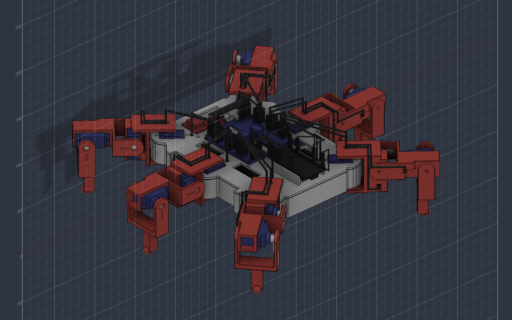

# Hexapod Mini: design

**Hexapod Mini** is a cheap little brother for [Hexapod Mk1](../../docs/DESIGN.md), and it is remote-control only.

**Brief:**

- under **US$200 for everything**, including filament, battery, charger and remote;
- walk, turn and strafe from a hand-held remote;
- rechargeable;
- safe for Oli to build.

**What it is:**

- **About 150 × 170 mm body, 230 mm across the feet, about 660 g**, standing 45 mm off the floor (18 mm ground clearance).
- **18 × MG90S** micro servos: 3 per leg, coxa, femur and tibia.
- An **ESP32-DevKitC** with two **PCA9685** boards.
- An **8BitDo Lite 2** (or any Bluepad32) gamepad over Bluetooth.
- A **2S 18650 Li-ion** pack, with a BMS, a fuse and a switch.
- Two 5 V / 5 A bucks.
- **About $196 in total.** Itemised with links in [BOM.md](BOM.md).

| File | What it is |
| --- | --- |
| [cad/mini_hexapod_fusion.py](../cad/mini_hexapod_fusion.py) | Parametric Fusion generator. It builds every part, the assembly, joints with limits, rigid groups, every wire and plug, fillets and chamfers. It works in its own document ("Hexapod Mini") |
| [cad/Hexapod_Mini.f3d](../cad/Hexapod_Mini.f3d) | Fusion archive of the generated design |
| [cad/stl/](../cad/stl/) | One STL per printed part, in print orientation; `print_sizes.json` |
| [cad/build_report.json](../cad/build_report.json) | Parts, finishing, mass estimate, wire lengths, channel map |
| [cad/load_calc_mini.py](../cad/load_calc_mini.py) | Servo torque check (§4) |
| [cad/interference_sweep_mini.py](../cad/interference_sweep_mini.py), [cad/interference_report.json](../cad/interference_report.json) | Fusion interference analysis at the joint limits (§5) |
| [BOM.md](BOM.md), [WIRING.md](WIRING.md), [BUILD.md](BUILD.md) | Parts and prices, wiring, how to build it |
| [../firmware/](../firmware/) | ESP32 firmware: IK, tripod gait, gamepad, failsafes, USB `S,` protocol |

## 1. Choices and trade-offs

| Decision | Chosen | Rejected | Why |
| --- | --- | --- | --- |
| Actuators | 18 × MG90S (PWM, metal gears), $43 | Feetech SCS0009 bus servos ($110–160); SG90 (plastic gears) | Only PWM micro servos fit the budget. Metal gears survive a falling robot |
| Servo driver | 2 × PCA9685 (one per side) | ESP32 LEDC on 18 pins | Hardware PWM with no jitter, an OE pin that switches all servos off at once, simple wiring |
| Remote | Bluetooth gamepad + Bluepad32, $21 | ExpressLRS handset + receiver ($70–100) | It costs a fifth as much and uses the ESP32's own radio. 10 m indoors is enough for a desk robot |
| Controller | ESP32-DevKitC (classic ESP32) | ESP32-S3 | Bluepad32 supports DualShock 4, Switch Pro and 8BitDo pads over Bluetooth Classic on the classic ESP32 only |
| Battery | 2 × 18650 Li-ion (Molicel P28A), 2S, in a holder | 2S LiPo pouch | Steel cans are robust. They charge outside the robot in a $7 USB charger, one cell at a time, with no balance charger or LiPo bag. P28A gives 35 A, far above the 8 A peak |
| Protection | 2S BMS + 10 A fuse + switch + firmware cut-off at 6.6 V | Firmware cut-off only | The BMS still protects the cells if the robot is left on or the firmware hangs |
| Servo power | 2 × Mini560 5 V / 5 A, one per side | One XL4015 / 20 A module | Small enough to hang under the deck. Each side gets its own 5 A |
| Body | Tray + deck that clamps the coxa servo tabs, battery bay with a hatch | Two-plate sandwich like Mk1 | Fewer parts. The deck is both lid and servo clamp. The battery comes out from below with 2 screws |
| Legs | Same printed parts on all six legs (turned, not mirrored) | Left and right parts | 3 STLs × 6. The servo direction is the same on every leg |

## 2. Geometry and frames

**Same conventions as Mk1 and the simulator.**

- **Fusion:** +X right, +Y forward, +Z up, origin in the hip plane.
- **Sim:** x left, y up, z forward.
- **Sim leg frame:** x out, y up, z "forward". Femur + is up; the tibia angle is relative to the femur.

| Parameter | Value |
| --- | --- |
| Coxa / femur / tibia | 30 / 44 / 60 mm |
| Coxa axes | (±48, ±72) at ±40° and (±60, 0) at 0° / 180° |
| Stand height | 45 mm (35–55 adjustable) |
| Foot reach | 58 mm (neutral) |
| Stance window (load check) | 52–61 mm middle legs, 52–70 mm corner legs |
| Joint limits (sim) | coxa ±25° (gait uses ≤ 16°, body clear to ±40°); femur −35…+55°; tibia −130…−40° |

**Leg build.** Each joint is a micro servo held in the upstream link, with a printed U around it on the downstream side:

- a **horn arm** screwed to the servo horn;
- an **idler arm** on the far side, turning on an M3 pin that self-taps into the arm and spins in a 3.4 mm hole in the upstream part.

So no joint hangs on the servo's output shaft alone. The coxa link wraps round the tray edge like a C:

- the upper arm is on the coxa horn;
- the web is outside the tray;
- the lower arm has the coxa pivot pin under the floor.

The tray edge is cut back wherever the web sweeps.

## 3. Mass

<!-- gen:MASS_TABLE -->
*(generated from cad/build_report.json)*

| Printed parts | Bought parts | Screws | Wiring | **Total** |
| --- | --- | --- | --- | --- |
| 216 g | 410 g | 18 g | 14 g | **658 g** |

| Printed part | Qty | Volume (cm³) | Est. mass each (g) |
| --- | --- | --- | --- |
| Tray | 1 | 56.7 | 38.7 |
| Deck | 1 | 39.4 | 26.9 |
| BatteryHatch | 1 | 16.1 | 11.0 |
| Coxa | 6 | 15.2 | 10.4 |
| Femur | 6 | 9.9 | 6.8 |
| Tibia | 6 | 8.9 | 6.0 |
<!-- /gen:MASS_TABLE -->

**How the numbers were made:**

- **Printed parts:** CAD volume × 1.24 g/cm³ × 0.55. The 0.55 assumes PLA, 3 walls, 25 % gyroid.
- **Bought parts:** listing weights. The MG90S is 13.4 g; one P28A is 46.5 g.
- **Screws and wiring:** estimates.
- **Weigh the real robot** and re-run `python cad/load_calc_mini.py <kg>`.

## 4. Load check: servo torque ≥ 2 × rated for the robot's own weight

`cad/load_calc_mini.py` checks the worst static case. The robot stands on a tripod (3 feet down), at walking height, with each stance foot anywhere in its stance window.

**Foot loads.** The foot loads are solved from the tripod geometry, which is stricter than Mk1's equal m g / 3. The **lone middle foot carries 44 %** of the weight; each corner foot carries 28 %.

**Torques.**

| Joint | Torque |
| --- | --- |
| Femur | F × (horizontal femur axis → foot) |
| Tibia | F × (horizontal tibia axis → foot) |
| Coxa | 0.3 × F × reach (a sideways push) |

**What "rated" means here.** The MG90S datasheet gives one torque figure: **1.8 kg·cm at 4.8 V, 2.2 kg·cm at 6.0 V**. That is its stall torque. At our 5.0 V it interpolates to **1.87 kg·cm**, and that datasheet figure is used as "rated", because hobby servos have no separate continuous rating.

<!-- gen:LOAD_TABLE -->
*(generated from cad/load_calc_mini.py, robot 0.66 kg, MG90S datasheet torque 1.87 kg·cm at 5.0 V)*

| Case | Foot load (N) | Stance window (mm) | Coxa: required / margin | Femur: required / margin | Tibia: required / margin |
| --- | --- | --- | --- | --- | --- |
| tripod, lone middle foot (44 % of weight) | 2.84 | 52–61 | 0.53 kg·cm / **3.53×** | 0.90 kg·cm / **2.08×** | 0.59 kg·cm / **3.15×** |
| tripod, corner foot (28 % of weight) | 1.81 | 52–70 | 0.39 kg·cm / **4.82×** | 0.74 kg·cm / **2.53×** | 0.38 kg·cm / **4.93×** |
| Mk1 convention: m g / 3, feet out to 70 mm | 2.15 | 52–70 | 0.46 kg·cm / **4.05×** | 0.88 kg·cm / **2.13×** | 0.45 kg·cm / **4.15×** |
| for reference: lone middle foot out to 70 mm (no clamp) | 2.84 | 52–70 | 0.61 kg·cm / **3.07×** | 1.16 kg·cm / **1.61×** | 0.59 kg·cm / **3.15×** |
<!-- /gen:LOAD_TABLE -->

**Result: every joint has at least 2 × the datasheet torque in the worst case.**

The femur is the limit, so:

- The gait's **stance-window rule** keeps the middle feet within 61 mm of their coxa axes. `REACH_MAX_MIDDLE` in `config.h`, the same rule as Mk1.
- Without the rule, the femur margin falls to about 1.6×, as the last row shows.

**What the margin does not cover:**

- **Continuous load.** Mk1's bus servos have a continuous rating of about ⅓ of stall. Judged that way, the MG90S femurs work at about 50 % of stall while the robot stands, which is close to their continuous limit. Small servos get warm when held.
- **What the firmware does about it:** it sits the robot down and goes limp whenever it is disarmed or the pad is lost.
- **What to do as the builder:** sit the robot down between runs. Don't add payload. Every 50 g on the deck costs about 0.15 of femur margin.

## 5. Interference check

**How the check is done.** `cad/interference_sweep_mini.py` runs **Fusion's own interference analysis** (`Design.analyzeInterference`) on the assembly:

- every printed part;
- every bought-part envelope;
- every wire and plug.

The poses:

- the modelled pose;
- each leg on its own through 20 poses at and past its limits: coxa ±40°, femur −55…+35° (Fusion), tibia −50…+40°, and corner combinations;
- neighbouring legs swung towards each other to the firmware coxa limit (±25°), with the femur and tibia at both extremes.

**What is filtered out.** Only contacts that are meant to be there:

- a wire ending in its plug or on its terminal;
- the two halves of one servo lead meeting at a joint ("splice");
- a plug on its header.

<!-- gen:SWEEP_TABLE -->
*(generated from cad/interference_report.json)*

**139 of 139 poses clean** (Fusion interference analysis, intended contacts filtered).

| Mode | Poses | Clean |
| --- | --- | --- |
| modelled pose | 1 | 1 |
| neighbouring legs at the 25° coxa limit | 18 | 18 |
| leg 0 alone | 20 | 20 |
| leg 1 alone | 20 | 20 |
| leg 2 alone | 20 | 20 |
| leg 3 alone | 20 | 20 |
| leg 4 alone | 20 | 20 |
| leg 5 alone | 20 | 20 |
<!-- /gen:SWEEP_TABLE -->

**What the sweep found and fixed on the way:**

- The corner servos' tabs were inside the tray wall. The tray radius round each coxa went up to 14 mm, and the sweep cut-outs were limited to 45 mm.
- The tibia idler arm touched the femur skin at full tibia travel. The skin was shortened.
- Neighbouring legs collide beyond about 30° of coxa swing towards each other. The coxa limit is now **25°**; the gait never uses more than 16°.
- Fillets in the servo pockets, at the coxa horn and in the femur cradle touched the servos by 0.1–9 mm³. Fillets now skip edges within 2 mm of a servo or horn.

## 6. Control

**Firmware:** [firmware/README.md](../firmware/README.md).

**Walking.** The gait is a tripod (legs 0, 2, 4 and then 1, 3, 5):

- 15 mm step height;
- 2.0 Hz walking, 2.8 Hz with R1 held;
- up to 0.10 m/s and 0.9 rad/s.

**Stance-window rule.** Speed is scaled down whenever a stance foot would leave its window. This is why strafing is slower (about 0.03–0.05 m/s) than walking forward (about 0.08–0.10 m/s): a sideways step changes the middle legs' reach directly.

**Arming.** The robot starts **limp** (PCA9685 OE high). To arm, press A: the robot stands up over 1.5 s.

**Stopping.** It sits down and goes limp on any of these:

- B is pressed;
- the gamepad is silent for 3 s;
- the battery is below 6.6 V for 3 s.

The robot also speaks the sim's USB `S,` servo protocol, so the browser sim can drive it later.

## 7. Printability

<!-- gen:PARTS_TABLE -->
*(generated from cad/build_report.json and cad/stl/print_sizes.json)*

| Part | Qty | Bed face | Printed size (mm) | Fillets | Bed-chamfer edges | Edge breaks | 180 bed |
| --- | --- | --- | --- | --- | --- | --- | --- |
| Tray | 1 | (0, 0, -1) | 148 × 172 × 24 | 40 | 42 | 0 | ✓ |
| Deck | 1 | (0, 0, -1) | 148 × 172 × 11 | 16 | 155 | 0 | ✓ |
| BatteryHatch | 1 | (0, 0, -1) | 64 × 120 × 2 | 0 | 20 | 0 | ✓ |
| Coxa | 6 | (0, -1, 0) | 47 × 40 × 29 | 4 | 18 | 9 | ✓ |
| Femur | 6 | (0, 0, -1) | 66 × 40 × 18 | 6 | 14 | 14 | ✓ |
| Tibia | 6 | (-1, 0, 0) | 68 × 40 × 16 | 7 | 16 | 10 | ✓ |
<!-- /gen:PARTS_TABLE -->

**Finishing.** Every part gets three kinds of finishing:

- **Fillets** on inside corners: 1.5 mm along the print-vertical axis, 0.8 mm elsewhere. They are skipped next to servos.
- **A 0.4 mm chamfer** on the bed-side edges, against elephant foot.
- **0.6 mm edge breaks** on the top faces of the leg parts.

**Supports.** Holes that are horizontal in the print are teardrops, so no part needs supports.

**Bed size.** Everything fits a 180 × 180 mm bed. The largest part is the tray, at about 148 × 172 mm.

## 8. Not verified

- **Nothing has been printed, built or flashed.**
- **Servo envelope.** The MG90S is modelled from typical datasheet dimensions, not a vendor STEP. Print the coxa fit test first (BUILD.md step 1).
- **Bought-part envelopes.** The PCA9685, ESP32-DevKitC, Mini560, BMS, holder, switch and fuse holder are modelled as envelopes from listing dimensions.
- **Mass.** It is a CAD estimate. Weigh the real robot.
- **Servo directions.** The firmware's servo directions are an assumption, checked on the stand. The sketch has not been compiled against the real Bluepad32 core.
- **Prices.** They were checked on 2026-11-25/26. Rows marked approx. in BOM.md are typical listing prices.
