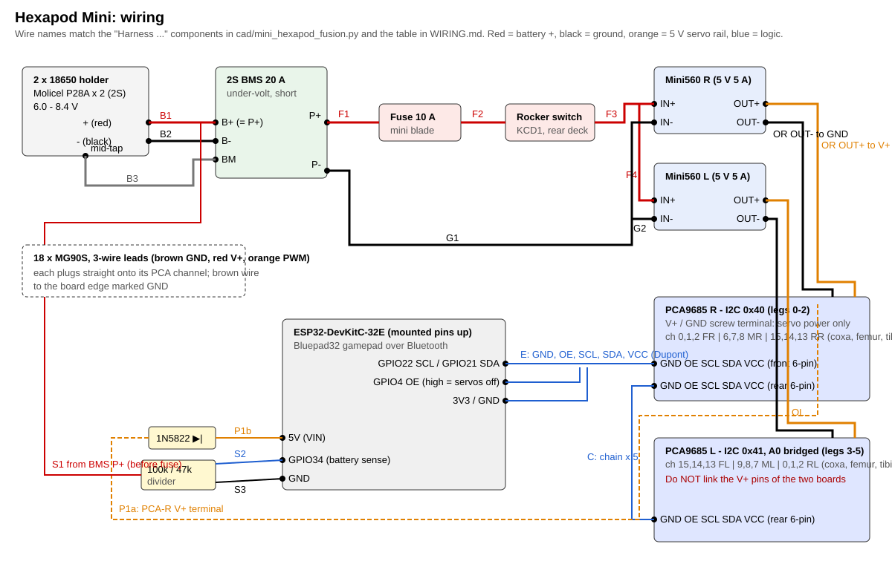

# Hexapod Mini: wiring



Every wire below is modelled in the CAD as a **Harness …** component, routed where it goes in the robot. The [interference sweep](DESIGN.md#5-interference-check) checks all of them against the printed parts at every leg pose.

The lengths in the table are the CAD route lengths. **Cut each wire 15 % longer** to leave room for bends and service loops.

## 1. Power path

```
2 x 18650 (2S, 6.0-8.4 V) -> 2S BMS (cuts off a cell below ~2.7 V, and on a short) -> 10 A fuse -> rocker switch
   -> Mini560 R (5.0 V, 5 A) -> PCA9685 R V+ terminal -> 9 right-side servos
   -> Mini560 L (5.0 V, 5 A) -> PCA9685 L V+ terminal -> 9 left-side servos
PCA9685 R V+ terminal -> 1N5822 Schottky -> ESP32 5V pin   (ESP32 logic, ~0.1 A; the diode stops USB
                                                             power flowing back into the servo rail)
ESP32 3V3 -> PCA9685 VCC (logic, both boards)
BMS P+ -> 100k / 47k divider -> GPIO34   (battery voltage; reads 2.69 V at 8.4 V)
```

**The two PCA9685 V+ rails are kept apart.** Each board is fed by its own buck.

- Don't put a wire on the V+ pin of the 6-pin chain header.
- The board's reverse-polarity protection only covers VCC.

**Grounds.** Everything shares one ground:

- BMS P− → both buck IN−;
- buck OUT− → PCA GND terminal;
- PCA logic GND → ESP32 GND.

**Current budget** (estimates, to check on the first run):

| State | Battery current | Notes |
| --- | --- | --- |
| Disarmed (servos limp, Bluetooth on) | ~0.12 A | ESP32 plus the two PCA logic supplies |
| Standing | ~0.6–1.0 A | 18 servos holding |
| Walking | ~2–3 A average | about 3 A at 5 V on the servo side |
| Peak (all servos stepping together) | ~6–8 A | the fuse is 10 A; each buck limits at about 5 A |

**Runtime.** 2.8 Ah × 80 % gives about **50–70 min of walking** or about 2 h standing.

**Low battery.** The firmware sits the robot down and goes limp below 6.6 V (3.3 V per cell, under load).

**Leaving it on.** Switch off after use. If it is left on, it uses about 0.12 A and would flatten the pack in about a day. The BMS cuts off before the cells are damaged.

## 2. Servo channels

Each servo plugs straight onto its PCA9685 channel. The **brown wire goes to the edge marked GND**.

| Leg | Board (I2C address) | Coxa | Femur | Tibia |
| --- | --- | --- | --- | --- |
| 0 front-right | R (0x40) | 0 | 1 | 2 |
| 1 middle-right | R (0x40) | 6 | 7 | 8 |
| 2 rear-right | R (0x40) | 15 | 14 | 13 |
| 3 front-left | L (0x41) | 15 | 14 | 13 |
| 4 middle-left | L (0x41) | 9 | 8 | 7 |
| 5 rear-left | L (0x41) | 0 | 1 | 2 |

- The left board is turned 180°, so its channel numbers mirror the right board's.
- Bridge the **A0** pads on the left board to make it 0x41.
- The table is `CHANNEL` in both the CAD and `firmware/mini_hexapod/config.h`. Change both together.

**Lead routing.** The servo leads leave the plugs straight up and run to their leg at three heights: coxa leads 25 mm, femur 27.5 mm and tibia 30 mm above the hip plane. That way no two leads cross at the same height.

- **Coxa servo leads** come up through the hole in the deck beside their servo.
- **Femur and tibia leads** run over the top of the coxa link, down its outer (−Y) side and into the femur servo lead channel.
- **Tibia leads** cross the femur joint just above the femur pin head, then run along the femur's outside and in through the slot in the femur's cradle.

Leave a **30 mm service loop** at each joint and tie the leads to the links with thin zip ties. A lead pulled tight at full swing is the commonest way to break a micro servo's wires.

## 3. Wire list

<!-- gen:WIRE_TABLE -->
| CAD name | From → to | Wire | Length (CAD route) |
| --- | --- | --- | --- |
| Leg0 coxa lead | MG90S leg 0 coxa → PCA9685 channel (WIRING §2) | servo lead (3-core) | 96 mm |
| Leg0 femur lead | MG90S leg 0 femur → PCA9685 channel (WIRING §2) | servo lead (3-core) | 174 mm |
| Leg0 tibia lead | MG90S leg 0 tibia → PCA9685 channel (WIRING §2) | servo lead (3-core) | 200 mm |
| Leg1 coxa lead | MG90S leg 1 coxa → PCA9685 channel (WIRING §2) | servo lead (3-core) | 62 mm |
| Leg1 femur lead | MG90S leg 1 femur → PCA9685 channel (WIRING §2) | servo lead (3-core) | 142 mm |
| Leg1 tibia lead | MG90S leg 1 tibia → PCA9685 channel (WIRING §2) | servo lead (3-core) | 165 mm |
| Leg2 coxa lead | MG90S leg 2 coxa → PCA9685 channel (WIRING §2) | servo lead (3-core) | 80 mm |
| Leg2 femur lead | MG90S leg 2 femur → PCA9685 channel (WIRING §2) | servo lead (3-core) | 161 mm |
| Leg2 tibia lead | MG90S leg 2 tibia → PCA9685 channel (WIRING §2) | servo lead (3-core) | 183 mm |
| Leg3 coxa lead | MG90S leg 3 coxa → PCA9685 channel (WIRING §2) | servo lead (3-core) | 96 mm |
| Leg3 femur lead | MG90S leg 3 femur → PCA9685 channel (WIRING §2) | servo lead (3-core) | 176 mm |
| Leg3 tibia lead | MG90S leg 3 tibia → PCA9685 channel (WIRING §2) | servo lead (3-core) | 198 mm |
| Leg4 coxa lead | MG90S leg 4 coxa → PCA9685 channel (WIRING §2) | servo lead (3-core) | 62 mm |
| Leg4 femur lead | MG90S leg 4 femur → PCA9685 channel (WIRING §2) | servo lead (3-core) | 143 mm |
| Leg4 tibia lead | MG90S leg 4 tibia → PCA9685 channel (WIRING §2) | servo lead (3-core) | 164 mm |
| Leg5 coxa lead | MG90S leg 5 coxa → PCA9685 channel (WIRING §2) | servo lead (3-core) | 80 mm |
| Leg5 femur lead | MG90S leg 5 femur → PCA9685 channel (WIRING §2) | servo lead (3-core) | 159 mm |
| Leg5 tibia lead | MG90S leg 5 tibia → PCA9685 channel (WIRING §2) | servo lead (3-core) | 185 mm |
| B1 holder + to BMS B+ | holder + → BMS B+ | 20 AWG red | 23 mm |
| B2 holder - to BMS B- | holder − → BMS B− | 20 AWG black | 23 mm |
| B3 holder mid-tap to BMS BM | holder mid-tap → BMS BM | 20 AWG | 153 mm |
| F1 BMS P+ to fuse | BMS B+ (P+) → fuse | 20 AWG red | 142 mm |
| F2 fuse to switch | fuse → switch | 20 AWG red | 26 mm |
| F3 switch to buck R IN+ | switch → Mini560 R IN+ | 20 AWG red | 36 mm |
| F4 buck R IN+ to buck L IN+ | Mini560 R IN+ → Mini560 L IN+ | 20 AWG red | 45 mm |
| G1 BMS P- to buck R IN- | BMS P− → Mini560 R IN− | 20 AWG black | 132 mm |
| G2 buck R IN- to buck L IN- | Mini560 R IN− → Mini560 L IN− | 20 AWG black | 63 mm |
| OR buck R OUT+ to V+ | Mini560 R OUT+ → PCA9685 R V+ | 20 AWG red | 60 mm |
| OR buck R OUT- to GND | Mini560 R OUT− → PCA9685 R GND | 20 AWG black | 72 mm |
| OL buck L OUT- to GND | Mini560 L OUT− → PCA9685 L GND | 20 AWG black | 50 mm |
| OL buck L OUT+ to V+ | Mini560 L OUT+ → PCA9685 L V+ | 20 AWG red | 63 mm |
| P1a PCA-R V+ to diode | PCA9685 R V+ terminal → 1N5822 anode | 26 AWG Dupont | 100 mm |
| P1b diode to ESP32 5V | 1N5822 cathode → ESP32 5V | 26 AWG Dupont | 46 mm |
| E GND ESP32 to PCA-R | ESP32 → PCA9685 R front header GND | 26 AWG Dupont | 19 mm |
| E OE ESP32 to PCA-R | ESP32 → PCA9685 R front header OE | 26 AWG Dupont | 61 mm |
| E SCL ESP32 to PCA-R | ESP32 → PCA9685 R front header SCL | 26 AWG Dupont | 32 mm |
| E SDA ESP32 to PCA-R | ESP32 → PCA9685 R front header SDA | 26 AWG Dupont | 45 mm |
| E VCC ESP32 3V3 to PCA-R | ESP32 → PCA9685 R front header VCC | 26 AWG Dupont | 66 mm |
| C GND PCA-R to PCA-L | PCA9685 R rear header → PCA9685 L rear header GND | 26 AWG Dupont | 31 mm |
| C OE PCA-R to PCA-L | PCA9685 R rear header → PCA9685 L rear header OE | 26 AWG Dupont | 39 mm |
| C SCL PCA-R to PCA-L | PCA9685 R rear header → PCA9685 L rear header SCL | 26 AWG Dupont | 48 mm |
| C SDA PCA-R to PCA-L | PCA9685 R rear header → PCA9685 L rear header SDA | 26 AWG Dupont | 56 mm |
| C VCC PCA-R to PCA-L | PCA9685 R rear header → PCA9685 L rear header VCC | 26 AWG Dupont | 64 mm |
| S1 BMS P+ to divider | BMS P+ → divider (100 kΩ) | 26 AWG | 44 mm |
| S2 divider to GPIO34 | divider mid → ESP32 GPIO34 | 26 AWG Dupont | 51 mm |
| S3 divider to ESP32 GND | divider foot (47 kΩ) → ESP32 GND | 26 AWG Dupont | 57 mm |

*(generated from cad/build_report.json: 46 wires; the servo leads are the leads on the servos, the lengths show what each lead must reach - the MG90S lead is about 250 mm)*
<!-- /gen:WIRE_TABLE -->

## 4. Rules for a safe build

1. **Charge the cells outside the robot**, in the XTAR charger, on a non-flammable surface. The robot has no charging port on purpose.
2. **Polarity.**
   - Check every new joint with the meter **before** a cell goes in: holder red → BMS B+, black → B−.
   - The mid-tap goes to the holder's middle contact, where the two cells join.
3. **Fuse first.** Fit the fuse holder in the P+ wire straight after the BMS. Never bypass it.
4. **Set nothing.** The Mini560 is a fixed 5.0 V module. Check its output with the meter (5.0 ± 0.2 V) before connecting a PCA9685.
5. **Heat-shrink every solder joint.** Strain-relieve the battery leads with a zip tie to the tray.
6. **Bluetooth and power.** The robot arms only when you press A on the gamepad. It goes limp on its own if the pad disconnects or the battery runs low.
